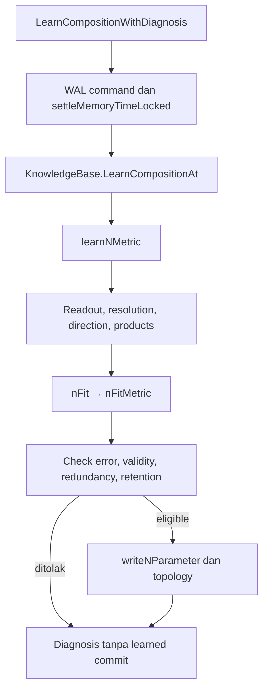

# S2-R1 — Root Cause Audit

**Status: DIAGNOSED**, untuk penyebab operasional kegagalan recruitment dan berhentinya admission pada 16 command S2. Nilai prediktif independen forecast dan magnitude error historis tetap **INCONCLUSIVE**. Diagnosis ini tidak mempromosikan kemampuan S2 menjadi lulus dan tidak memvalidasi perbaikan S2-R2.

Experiment ID: `s2r1-20261116-native-learning-diagnostic`. Lineage tetap Canonical A–E1 → S1 → S2. Semua intervensi berupa perhitungan pada model/salinan runtime terisolasi; tidak ada kandidat counterfactual yang dipasang, pelatihan baru, penggantian checkpoint, atau perubahan hukum belajar.

## 1. Tujuan, implementasi, pengujian, keputusan

| Penilaian | Hasil |
| --- | --- |
| Tujuan | Menjelaskan mengapa kanal tambahan belum direkrut dan mengapa command 5–16 tidak menghasilkan learned commit. |
| Implementasi | Menelusuri learner v6 yang benar-benar digunakan S2, memverifikasi source, mereplay WAL asli, dan mengevaluasi model bertanda sinaps yang sama. |
| Pengujian | 16/16 receipt historis cocok persis, termasuk 1.260 trial kandidat; lima kondisi input; 12 kontrol sintetis; 144 basis counterfactual; intervensi bobot, witness, dan langkah refit; 224 kandidat ranking 9–64. |
| Keputusan | Penyebab utama teridentifikasi: proposal refit penuh yang menggabungkan fitur baru dengan penggantian seluruh readout query. Admission menolak proposal penuh yang memang memperburuk check set, sementara langkah parameter yang lebih kecil dapat memberi gain dan mempertahankan retensi. Pengulangan deterministik kemudian mengulang kegagalan yang sama. |
| Langkah berikutnya | Rencanakan proposal pembaruan readout yang dibatasi terhadap incumbent pada S2-R2, dengan gate yang sama dan evaluasi baru yang dipisahkan dari fit. Belum dijalankan. |

## 2. Sumber, integritas, dan ruang lingkup

| Komponen | Terverifikasi |
| --- | --- |
| Baseline main | `11c6e0a78547d68a0be8f78b3c801e912722608d` |
| Referensi penelitian | PR #74, HEAD `70dbf8a36a13abdd8c763b73566d64b7b3025b96` |
| Arsip asli | `Horizon_S2_Native_Self_Evaluation_20261116.tar.xz`, 61.142.188 byte |
| SHA-256 arsip | `661d007850d3026ed22636fdc4d96e9113115fb2b9e2d66856ad88e4ba60a49f` |
| Checkpoint | `s2/lineage/s2-continuation.json`, sequence **76617** |
| Native checksum | `b87285e38a321d45e4da920f219b388d1a2d061554042d2dd0f109883b38ab9d` |
| Inventaris | 264 neuron, 6.244 sinaps, 24 PatternSynapses, 30 fitur numerik |
| Native policy | 10.752 updates, dipertahankan |
| Learned commits S2 | Empat; seluruh 16 command tetap tercatat di WAL |
| Autentikasi | 75/75 payload cocok manifest sebelum dan sesudah diagnosis |

Recovery native memeriksa checkpoint dan journal lengkap pada salinan. Replay suffix historis dari sequence 76346 menghasilkan continuation 76617 yang identik dengan runtime yang dipulihkan langsung. Replay merupakan pemulihan command yang sudah tersimpan, bukan akuisisi atau pelatihan ulang baru. `new_learning_commands = 0`.

Perbandingan byte-field sinaps S1 continuation dengan S2 continuation juga memverifikasi **5.820 sinaps sumber tetap identik, 424 ditambahkan, nol diubah/dihapus**, dan native-control state identik. Ini audit preservasi state historis, bukan pengujian generalisasi retensi baru. Bukti: [s1-s2-preservation.json](evidence/s1-s2-preservation.json).

Artefak historis dibuat read-only. Identitas Brain tetap identitas kanonik pada setiap salinan; identitas eksperimen dibedakan melalui direktori, protokol dan metadata hasil. Main dan branch PR #74 tidak diubah. Source produksi, learning law, threshold, ceiling, dan checkpoint tidak diedit.

Final holdout S2 tidak dimuat secara semantik, dievaluasi, atau digunakan untuk memilih intervensi. Byte payload holdout hanya ikut autentikasi manifest. Metrik dalam laporan ini berasal dari data pengembangan/command historis atau stimulus sintetis diagnosis, **bukan generalisasi independen**.

Bukti: [source-validation.json](evidence/source-validation.json), [source-after.json](evidence/source-after.json), log `diagnostic-receipts.log`. Lokasi fungsi dan hash file ada pada [code-map.json](evidence/code-map.json).

## 3. Call graph yang benar-benar berjalan

| Fungsi/lokasi pada HEAD referensi | Perilaku yang diaudit | Bukti eksekusi |
| --- | --- | --- |
| `runtime/neural_composition.go:260`, `LearnCompositionWithDiagnosis` | Validasi, deduplikasi ID, transaksi WAL, pemanggilan learner, receipt yang dibekukan. | 16 receipt dan sequence historis cocok. |
| `runtime/journal_command.go:13`, `runJournalCommandLocked` | Command ditulis sebelum mutasi; sequence command bertambah walaupun learned commit ditolak. | Command 76351–76354 dan 76595–76602 tetap ada; learned commit false. |
| `knowledge/neural_composition.go:586`, `LearnCompositionAt` | Cabang numerical v6 langsung memilih `learnNMetric` pada satu KnowledgeBase. | Trace native v6 cocok dengan seluruh trial historis. |
| `knowledge/neural_resolution.go:262`, `loadNModel` | Axis, center, delta, bias dan bobot query dibaca kembali dari sinaps kanonik. | 64 nilai model diagnostik identik dengan API `ReadComposition`. |
| `knowledge/neural_metric_learning.go:75` | Setiap kandidat dicoba dalam mode activation dan metric; seluruh readout query di-fit ulang. | Trial menyimpan mode, parameter usulan, fit/check error dan gate. |
| `knowledge/neural_metric.go:222`, `nFitMetric` | Bounded least squares, normalisasi kolom, penanganan kolom konstan; mengganti W dan bias query. | Tidak ada fit-invalid pada 1.260 trial historis. |
| `knowledge/neural_metric_learning.go:299` | Hanya kandidat terpilih yang memasang parameter/neuron/witness. | Empat fitur 261–264 terbentuk; source tambahan tetap kosong. |
| `knowledge/neural_resolution.go:578`, `writeNParameter` | Pasangan excitatory/inhibitory menyimpan nilai signed; eligibility dan metadata diperbarui saat instalasi. | Pemetaan signed parameter pada data diagnosis; intervensi diagnostik tidak memanggil instalasi. |

Prefix path pada tabel adalah `services/ai/`. Tracer dihasilkan dari source learner dengan SHA-256 terkunci `5cbd936e59145868a152c8e6f0ff7b08cf1a6fd30bb1ede579b2bb4136061db6`. Arithmetic pencarian dan admission dipertahankan; tracer berhenti sebelum instalasi dan pencatatan diagnosis. File diagnostik hanya dibangun dengan tag `horizon_s2r1`.

## 4. Encoding dan koordinat S2

`s2Input` (`runtime/s2_self_evaluation_test.go:94`) memanggil codec S1 kemudian **menambahkan dua baris di depan sequence**. `nInput` (`knowledge/neural_resolution.go:181`) membalik lag dan mengalikan enam nilai tiap baris dengan gate ketujuh. Penambahan di depan mempertahankan koordinat S1: kenaikan panjang sequence dan kenaikan indeks baris saling meniadakan. Kesetaraan koordinat 0–55 diperiksa pada 64 pengalaman.

| Koordinat N, indeks mulai nol | Isi | Source neuron continuation | Keadaan |
| --- | --- | --- | --- |
| 0–55 | Codec S1 asli, termasuk gate/padding | Source lama pada koordinat data yang pernah direkrut | Tetap identik dengan S1 |
| 56, 57, 58 | Tiga forecast S1 | `0, 0, 0` | Nilai tersedia, source belum direkrut |
| 59, 60, 61 | Tiga absolute error sebelumnya | `0, 0, 0` | Nilai tersedia, source belum direkrut |
| 62 | Gate baris forecast/history = 1 | `0` | Konstan, tidak membawa variasi |
| 63 | Ada/tidaknya history | `0` | Tersedia, belum direkrut |
| 64 | Operasi sebelumnya, kode -1/+1 | `0` | Tersedia, belum direkrut |
| 65–68 | Padding nol | `0` | Tidak membawa variasi |
| 69 | Gate baris history = 1 | `0` | Konstan |
| 70–447 | Ruang input yang belum dipakai | Tidak menjadi kanal S2 aktif | Padding |

Sequence memakai 10 dari batas 64 baris; dimensi numerik adalah **448**, bukan jumlah neuron. Forecast dan error masuk tanpa normalisasi tambahan tersembunyi karena kedua gate baris bernilai 1. Pada development, SD forecast sekitar 0,0645–0,1070, SD error-history 0,0087–0,0152, dan SD kode operasi historis 0,9920. Ada variasi nyata, termasuk pada magnitude error.

Seluruh 448 koordinat tersedia bagi pencarian arah residual (`neural_metric_learning.go:158`). Source neuron baru **tidak perlu sudah ada** untuk menyusun axis kandidat: `newNNode` baru dipanggil setelah kandidat memenangkan admission. Karena itu `Sources[j] == 0` membuktikan belum ada recruitment yang dipasang, bukan encoding gagal atau koordinat tidak terjangkau.

Peta lengkap tersedia pada [input-coordinate-map.json](evidence/input-coordinate-map.json) dan [CSV](evidence/input-coordinate-map.csv). Nilai synapse di sana adalah parameter signed dan pasangan dynamic weight `max(±parameter,0)/8`.

## 5. Aktivasi, fitur, sinaps dan readout

Perlu dibedakan: (1) nilai tersedia pada X, (2) aktivasi fitur numerik yang dihitung oleh `nMetricEvaluate`, (3) aktivitas recurrent yang tersimpan di runtime, dan (4) kontribusi ke readout. `ReadComposition` menghitung numerical preview tanpa menginjeksi X ke persistent activation state. Penerimaan API tidak merekrut source atau mengubah state.

Tujuh fitur linear yang diwarisi memiliki sumber hanya dari koordinat lama. Fitur kind 2 mengalikan **activation** parent; kind 3 mengalikan **metric** parent. Semua empat head continuation memakai mode readout **metric**. Aktivasi tanh yang jenuh tidak otomatis menghilangkan informasi metric.

Parent produk merupakan hubungan struktural dengan signed parameter tepat 1, divalidasi pada `knowledge/neural_resolution_validation.go:158`. `nMetricEvaluate` memakai parent topology tersebut; ia tidak mengalikan ulang strength parent-edge sebagai parameter bebas. Axis dan readout memakai parameter signed yang dimuat dari sinaps. Karena itu mengubah bobot parent produk sembarang akan keluar dari kontrak checkpoint, bukan intervensi plasticity yang sah untuk dipromosikan.

| Fitur baru S2 | Jenis | Parent | Bobot signed ke query S2 |
| --- | --- | --- | ---: |
| 261 | 2, produk activation | 243, 256 | +0,000551817611 |
| 262 | 3, produk metric | 228, 261 | −0,002681424870 |
| 263 | 2, produk activation | 240, 254 | −0,002278308294 |
| 264 | 2, produk activation | 238, 245 | −0,002408475716 |

Semua parent tersebut kembali ke axis lama. Tidak ada path dari 56–69 menuju readout S2. Maka perubahan apa pun pada kanal tambahan tidak bisa memengaruhi output continuation melalui graph yang tersimpan. Ini juga dibuktikan melalui eksekusi.

Contoh path yang berkontribusi: koordinat 0 → source 175 → axis neuron 174, parameter −0,08788612 → beberapa fitur turunannya dan head S2; bobot langsung 174 → query S2 adalah +0,01904300014. Menghapus edge readout 174 menaikkan RMSE development dari 0,00557035 menjadi 0,01990635.

Sebaliknya untuk koordinat 56: nilai numerik tersedia → axis kandidat memiliki koefisien nonzero → kandidat penuh ditolak → source neuron/sinaps baru tidak dipasang → kontribusi continuation tepat nol. Hubungan kandidat ditandai **ditolak oleh mekanisme pembelajaran**; path continuation ditandai **tersedia tetapi tidak direkrut**. Tidak ditemukan koordinat tambahan yang tidak dapat dijangkau oleh pencarian.

## 6. Intervensi input dan kontrol kemampuan learner

Pada 64 development rows, kondisi A asli, B forecast dihapus, C history dihapus, D keduanya diganti nilai terkontrol, dan E diberi variasi legal semuanya menghasilkan **0 perubahan prediksi**, maksimum delta **0**. Seluruh koordinat diperiksa langsung dan seluruh runtime tetap byte-identik.

Pada pencarian kandidat sebelum command 5 dan 9, penghapusan forecast, penghapusan history, permutation tambahan dengan seed 3203, dan pengalian magnitude history ×4 semuanya tetap menghasilkan nol kandidat terpilih. Namun axis residual berubah sesuai intervensi. Ini memisahkan informasi yang masuk ke pencarian dari informasi yang berhasil dipasang.

Kontrol positif menggunakan target diagnosis `.1 + .2 × coordinate`, pada salinan lineage yang sama dan dengan witness historis tetap ada. Seeds 3101, 3109, 3121 ditentukan sebelum eksekusi. Tidak ada hasil kontrol yang dipasang.

| Kontrol | Terpilih oleh arithmetic native yang sama | Arti |
| --- | ---: | --- |
| Hanya forecast coordinate 56 bervariasi | 3/3 | Kanal forecast dapat dijangkau dan dipelajari oleh model native |
| Hanya error coordinate 59 bervariasi | 3/3 | Kanal error dapat dijangkau dan dipelajari |
| Kanal lain ikut bervariasi independen | 2/6 | Interferensi/fitting dan retensi memengaruhi admission; bukan hard ban kanal |

Kontrol yang ditolak ketika kanal lain bervariasi memiliki gain check tetapi gagal retensi. Ini contoh penolakan retensi yang sah pada **data diagnosis sintetis**, bukan penjelasan utama penolakan command 5–16 asli. Kontrol tersebut tidak membuktikan kemampuan actual-error estimation atau generalisasi baru.

Basis satu koordinat juga diuji sebagai proposal counterfactual, dengan delta ×1/16, ×1, ×16. Command 5 dan 9 tetap tidak menghasilkan gain check pada kandidat valid. Sembilan metric fits per command basis tidak valid; nilai mereka tidak digunakan sebagai nilai terbaik kandidat valid. Hasil negatif disimpan lengkap.

## 7. Audit 16 learning commands

Error berikut adalah **MSE check**, bukan RMSE dan bukan final holdout.

| Command | Fitur sebelum | Trial | Learned commit | MSE setelah | no-check-improvement | retention-regression |
| --- | ---: | ---: | --- | ---: | ---: | ---: |
| 1 | 26 | 72 | Ya | 8,85879376e-5 | 65 | 0 |
| 2 | 27 | 74 | Ya | 3,56701058e-5 | 66 | 0 |
| 3 | 28 | 76 | Ya | 3,32737643e-5 | 75 | 36 |
| 4 | 29 | 78 | Ya | 3,10287588e-5 | 70 | 0 |
| 5 | 30 | 80 | Tidak | 3,10287588e-5 | 80 | 3 |
| 6 | 30 | 80 | Tidak | 3,10287588e-5 | 80 | 3 |
| 7 | 30 | 80 | Tidak | 3,10287588e-5 | 80 | 3 |
| 8 | 30 | 80 | Tidak | 3,10287588e-5 | 80 | 3 |
| 9 | 30 | 80 | Tidak | 3,10287588e-5 | 80 | 41 |
| 10 | 30 | 80 | Tidak | 3,10287588e-5 | 80 | 41 |
| 11 | 30 | 80 | Tidak | 3,10287588e-5 | 80 | 41 |
| 12 | 30 | 80 | Tidak | 3,10287588e-5 | 80 | 41 |
| 13 | 30 | 80 | Tidak | 3,10287588e-5 | 80 | 41 |
| 14 | 30 | 80 | Tidak | 3,10287588e-5 | 80 | 41 |
| 15 | 30 | 80 | Tidak | 3,10287588e-5 | 80 | 41 |
| 16 | 30 | 80 | Tidak | 3,10287588e-5 | 80 | 41 |

Alasan penolakan dapat berimpit sehingga jumlah kolom alasan tidak harus sama dengan trial. Command 3 memiliki satu trial functionally-duplicate. Semua 1.260 fit historis valid. Trial yang diterima selama pencarian dapat digantikan kandidat lain pada command yang sama; total empat learned commits bukan jumlah seluruh trial eligible.

Untuk command 5, kandidat penuh terbaik menghasilkan MSE **3,46172161e-5**, lebih buruk dari incumbent **3,10287588e-5**. Untuk command 9, kandidat terbaik menghasilkan **3,55989466e-5**, juga lebih buruk. Tidak ada kandidat pada command 5–16 yang gagal **hanya** karena retensi.

`insufficient-predictive-evidence` adalah nilai awal/catch-all diagnosis (`neural_metric_learning.go:43`), bukan hasil pengujian bahwa input tidak memiliki informasi prediktif. Pada kasus ini artinya pencarian yang dijalankan tidak menemukan proposal yang melewati gate.

Hash model kandidat membuktikan set command 5–8 identik seluruhnya; set 9–16 juga identik seluruhnya. `TestS2Train` mengambil blok fit baru **sekali pada command 9**, bukan pada setiap command 9–16 (`s2_self_evaluation_test.go:362`). Tanpa learned commit, perubahan fit, atau perubahan witness, pencarian deterministik mengulang hasil yang sama. Tidak ada mekanisme akumulasi langkah yang ditolak menjadi pembelajaran diam-diam.

Data per command: [admission-summary.csv](evidence/admission-summary.csv). Semua trial: [candidate-trials.csv](evidence/candidate-trials.csv). Full trace menyimpan keadaan aktivasi sebelum command, native control, model sebelum/sesudah, parameter usulan, score ranking dan alasan setiap gate.

## 8. Penyebab kausal utama: proposal refit penuh

`nFitMetric` menyelesaikan objective fit lalu mengganti seluruh readout query. `consider` hanya mengevaluasi hasil penuh tersebut. Kandidat baru dengan demikian merupakan paket **fitur baru + refit seluruh W/bias**, bukan penambahan kontribusi baru sambil menahan incumbent. Fungsi admission menilai paket yang benar-benar diajukan, dan benar menolak paket yang memperburuk check error.

Intervensi mengubah **hanya parameter readout query yang diaudit** sepanjang garis dari incumbent ke proposal. Mode readout dan parameter fitur lama dipertahankan; factor 0 identik dengan incumbent. Fractions 0, .01, .05, .1, .25, .5, 1 ditentukan sebelum uji. Gate retensi, precision dan representasi signed tetap sama; kandidat tidak dipasang.

| Kasus | MSE incumbent | Full refit | Counterfactual lebih kecil | MSE counterfactual | Regresi witness |
| --- | ---: | ---: | --- | ---: | ---: |
| Command 5, trial 77, missing-relation | 3,10287588e-5 | 3,46172161e-5 | Fraction .1 | 3,09331218e-5 | 0 |
| Command 9, trial 73, missing-relation | 3,10287588e-5 | 3,84170246e-5 | Fraction .25 | 2,99718289e-5 | 0 |
| Command 9, trial 63, missing-direction | 3,10287588e-5 | 3,93435124e-5 | Fraction .1 | 3,09309989e-5 | 0 |

Indeks trial mulai nol. Ada 9 partial-step gain tanpa regresi pada command 5 dan 40 pada command 9. Nilai terbaik command 9 setara penurunan RMSE development sekitar **1,72%**; ini kecil dan tidak dianggap perbaikan S2 tervalidasi.

Temuan ini membuktikan bahwa ruang parameter yang sama, dengan ceiling dan syarat retensi yang sama, masih memiliki langkah bermanfaat. Penolakan penuh tidak membuktikan semua relasi di dalam kandidat tidak bermanfaat. Keterbatasannya ada pada **proposal perubahan yang diuji**, bukan bukti bahwa threshold harus diturunkan atau sinaps tidak mampu menyimpan relasi.

## 9. Forecast, history, dan kontribusi yang dipisahkan

Kandidat direction command 9 membawa bobot axis nonzero pada forecast dan history. Dalam continuation ia tidak terpasang. Pada fraction .1 yang belum dipasang, bobot readout fitur baru adalah +0,001721717025 dan MSE **3,093099885e-5**.

| Intervensi pada kandidat counterfactual tersebut | MSE development | Maksimum perubahan output |
| --- | ---: | ---: |
| Full input | 3,093099885e-5 | 0 |
| Forecast 56–58 dihapus | 3,090549436e-5 | 1,78048e-4 |
| Hanya magnitude error 59–61 dihapus | 3,093124982e-5 | 5,65454e-7 |
| History-presence 63 dihapus | 3,093099885e-5 | 0 |
| History-action 64 dihapus | 3,257037796e-5 | 8,90317e-4 |
| Seluruh kanal tambahan dihapus | 3,255815438e-5 | 1,06820e-3 |
| Kanal tambahan dipermutasi, seed 3301 | 3,423358601e-5 | 1,93465e-3 |

Ini atribusi kausal **komputasional pada model dan data tetap**: mengganti input mengubah hasil. Bukan bukti kausal dunia atau generalisasi independen. Manfaat history pada kandidat ini terutama berasal dari **operasi sebelumnya**. Magnitude error lama punya efek terukur yang jauh lebih kecil; penghapusannya menaikkan MSE sekitar 2,51e-10. Forecast justru sedikit memperburuk MSE kandidat ini karena penghapusannya menurunkan error.

Mengubah hanya readout lama pada fraction .1 menghasilkan MSE 3,63395692e-5; mengubah paket fitur baru bersama readout menghasilkan 3,09309989e-5. Jadi efek kandidat direction bukan sekadar penyesuaian fitur lama yang kebetulan dinamai recruitment. Namun klaim bahwa tiga magnitude error historis menyediakan gain praktis yang kuat tetap tidak didukung.

## 10. Retensi, witness, precision dan kuantisasi

`nMetricRegression` (`neural_metric.go:337`) membandingkan before/after pada **X, target, query dan witness yang sama**, serta memperhitungkan batas numerik/kuantisasi incumbent. Tidak ada operasi live atau waktu observasi berbeda di antara dua model dalam perbandingan ini.

Pada command 5 dan 9, seluruh rejection retensi berasal dari query S2 `[257,258,259,260]`, bukan tiga head S1. Menghapus witness S1 sambil mempertahankan witness S2 tidak memunculkan commit. Menghapus witness S2 pada salinan juga tidak memunculkan commit; kandidat terbaik malah memburuk menjadi sekitar 5,92593e-5 dan 7,33317e-5. Witness bukan penyebab tunggal pembekuan yang ditemukan di sini.

Ada batas validitas penting: setelah commit pertama, 32 dari 64 check episodes juga masuk fit melalui `state.Witnesses`. Source: append witness ke fit pada `neural_metric_learning.go:37`, simpan check sebagai witness pada `:378`, dan quota per head pada `neural_metric_support.go:41`. Validasi input hanya memeriksa Fit/Check yang dikirim caller, sebelum witness ditambahkan. Maka check ini tidak independen penuh pada command berikutnya. Kontrol tanpa witness S2 menghilangkan overlap tetapi tidak mengatasi stagnasi; overlap adalah masalah peran data/validasi yang terbukti, bukan akar tunggal stagnasi.

Required precision tetap .002. MSE incumbent 3,10e-5 masih jauh di atas goal²/4 = 1e-6, sehingga penghentian errorGain karena precision sudah tercapai tidak aktif. Selisih gagal utama sekitar 3,6e-6 sampai 8,3e-6, jauh di atas roundoff sekitar 1e-19. Tidak ditemukan gain utama yang tersembunyi oleh floating-point tolerance. Semua fit asli valid; varian basis yang tidak valid disimpan terpisah.

Kuantisasi nyata membatasi beberapa fitur: fitur 261 hanya memiliki dua nilai metric berbeda pada development, sedangkan 263/264 empat nilai. Banyak tanh activation bernilai ±1, tetapi readout continuation menggunakan metric dan tujuh axis lama memiliki 64 nilai metric berbeda. Mengalikan history ×4 dan mengubah basis delta ×1/16 sampai ×16 tidak membuka admission command 5/9. Saturasi/kuantisasi dapat menjadi keterbatasan representasi, tetapi tidak terbukti sebagai penyebab utama penolakan ini.

## 11. Causal credit dan interferensi

Recruitment v6 menggunakan covariance residual untuk satu arah baru dan score covariance ternormalisasi untuk produk parent. Itu atribusi statistik; pencarian **tidak** mengablasi tiap neuron atau sinaps untuk membuktikan kontribusinya. Least squares menyebarkan koefisien di antara fitur yang berkorelasi.

Native operation policy dan credit `LearnNativeObservedOutcome` / `LearnNativeOutcome` tetap ada pada N yang sama (`native_contrast.go:74`, `native_control.go:429`), tetapi learner numeric v6 bukan pemanggil jalur update policy tersebut. Pada pengumpulan S2, outcome memiliki `Learn:false`; update policy tetap 10.752. Maka kegagalan ini tidak dapat disimpulkan sebagai kerusakan causal credit policy. Yang terbukti adalah batas atribusi dan proposal pada learner numerik yang benar-benar berjalan.

`Dynamic.Eligibility` diperbarui saat instalasi sinaps sebagai `.9 × nilai_lama + abs(delta)`, tetapi tidak dipakai sebagai input seleksi axis, ranking produk, atau least-squares v6. `NTrial.Eligible` adalah hasil gate admission dan berbeda dari dynamic eligibility sinaps. Tidak ditemukan pengujian kontribusi kausal individual di dalam recruitment v6 itu sendiri; ablation di penelitian ini menambahkan bukti diagnostik, bukan hukum pembelajaran baru.

Intervensi edge readout dilakukan dengan factor 0, .5, −1, 1.5 tanpa refit. Dampak dihitung per operasi, bukan hanya besar bobot:

| Edge neuron → readout S2 yang dihapus | ΔRMSE pooled | Interpretasi pada development |
| --- | ---: | --- |
| 174 | +0,0143360 | Kontribusi kuat |
| 262 | +0,00140533 | Membantu; efek lebih besar pada stop |
| 263 | +0,000498760 | Membantu kedua operasi |
| 264 | +0,000440505 | Membantu kedua operasi |
| 244 | −0,0000432358 | Penghapusan membantu propagate tetapi sedikit merugikan stop |
| 256 | −0,00000130065 | Efek pooled kecil; membantu satu konteks dan merugikan konteks lain |

Ini menunjukkan neuron aktif tidak selalu membantu dan bobot besar tidak sama dengan manfaat bersih. Ablation edge memutus kontribusi langsung ke head; produk downstream masih ada. Intervensi axis/coarsening produk adalah intervensi berbeda, bukan diklaim sebagai perfect neuron clamp. Hasil kedua jenis intervensi disimpan lengkap di `causal-interventions.json.xz`. Tidak ada neuron lama yang dihapus atau dipangkas berdasarkan satu check set ini.

Zero-axis adalah counterfactual evaluasi yang sengaja memutus arah; jika dipersist, ia tidak memenuhi kontrak unit norm. Ia tidak pernah diserialisasi sebagai checkpoint atau diperlakukan sebagai kandidat instalasi yang sah. Kesimpulan utama tentang partial-step admission memakai axis asli yang tetap ternormalisasi.

## 12. Kapasitas dan pencarian

Continuation memiliki 30/32 fitur: tujuh axis linear, 17 produk metric dan enam produk activation. Guard growth masih aktif; trace menunjukkan direction dan delapan produk benar-benar dicoba pada seluruh command yang ditolak. Pada command 5/9 ada **907** proposal produk dalam ranking, hanya delapan yang di-fit pada pencarian asli. Evaluasi tambahan ranking 9–64, dua mode, total 224 trial tidak menemukan kandidat eligible. Ruang di luar ranking 64 belum dieliminasi sebagai kemungkinan; memperluas seluruh ruang bukan perbaikan yang sudah terbukti.

Satu snapshot recurrent memiliki 20 neuron nonzero dari 264. Itu ukuran state saat checkpoint, bukan jumlah neuron bebas atau aktivitas rata-rata sepanjang episode. Numerical preview menghitung graph fiturnya sendiri tanpa menulis persistent activation. Jumlah aktif yang rendah tidak membuktikan kelebihan atau kekurangan kapasitas.

Kontrol positif berhasil membentuk proposal fitur ke-31 tanpa mengubah ceiling. Partial-step counterfactual juga memakai paling banyak 31 fitur. Maka ceiling 32 dan total neuron tidak menjelaskan kegagalan saat ini. Interferensi yang terukur berada pada refit readout S2 dan witness S2; tidak ditemukan bahwa retensi S1 merupakan gate penentu penolakan command 5–16.

## 13. Klasifikasi akar penyebab

| Kelas | Keputusan dan keyakinan | Bukti pendukung | Bukti yang membatasi/bertentangan | Perubahan minimal yang relevan |
| --- | --- | --- | --- | --- |
| A — Input Encoding Failure | Tidak ditemukan, keyakinan tinggi untuk kanal yang diuji | Mapping 0–69 cocok; nilai forecast/history bervariasi dan axis kandidat merespons intervensi. | Tidak mencakup input perangkat/modality di luar harness S2. | Tidak memperbaiki codec berdasarkan dugaan. |
| B — Neural Recruitment Failure | Terdiagnosis secara operasional, tinggi | Kanal tersedia, axis kandidat memiliki bobot tambahan, tetapi proposal penuh kalah gate; Sources 56–69 kosong; output continuation invariant. | Native memilih kanal yang sama pada kontrol positif; tidak ada larangan struktural kanal. | Pisahkan keterjangkauan, proposal parameter dan keputusan instalasi dalam receipt; uji proposal yang dibatasi incumbent. |
| C — Learning Admission Failure | Bug gate tidak terbukti; tinggi untuk 16 command | Semua kandidat penuh command 5–16 memang gagal gain check; sebagian juga gagal retensi S2. | Parameter parsial bermanfaat tidak pernah diajukan oleh pencarian asli. Itu batas proposal, bukan gate salah menilai proposal tersebut. | Pertahankan gate/threshold. |
| D — Representation Capacity Limitation | Ceiling tidak menjadi sebab; batas representasi umum belum tuntas | 30 < 32 dan growth benar-benar dieksekusi; kontrol berhasil pada 31 fitur. | Produk terkuantisasi dan pencarian satu direction/top-eight terbatas; seluruh ruang tidak diuji. | Jangan menambah neuron/ceiling sebagai langkah pertama. |
| E — Insufficient Predictive Information | **INCONCLUSIVE** untuk manfaat independen forecast/magnitude error | Forecast tidak membantu pada satu counterfactual; efek magnitude error sangat kecil. | History-action membantu; kontrol menunjukkan kanal dapat digunakan. Check historis memiliki overlap fit dan bukan bukti independen. | Gunakan probe berpasangan dan check episodes baru pada S2-R2; jangan menyebut input pasti tidak berguna. |
| F — Other Verified Cause | **Terbukti, tinggi** untuk proposal dan replay ini | Refit penuh mengubah seluruh W/bias; partial parameter interventions memberi gain tanpa regresi; pengulangan candidate hashes menjelaskan command berulang. | Gain lokal kecil, tidak memvalidasi repair atau kecukupan S2 keseluruhan. | Proposal readout yang dibatasi terhadap incumbent; retry hanya jika bukti/state/proposal berubah. |

Masalah tambahan F yang terbukti adalah pencampuran peran check sebagai witness-fit (32 episode overlap), serta label catch-all `insufficient-predictive-evidence` yang terlalu mudah ditafsirkan sebagai klaim kandungan informasi. Menghapus witness tidak memperbaiki kegagalan asli, sehingga keduanya tidak dipaksakan menjadi sebab utama.

## 14. Rencana S2-R2 — spesifik, minimal, belum dijalankan

1. **Pertahankan sumber** continuation 76617 dan seluruh A–E1/S1/S2; lanjutkan Brain yang sama hanya pada tahap berikutnya yang diotorisasi. Jangan mengulang A–E1, S1 atau S2, mengganti learner, ataupun membuat controller.
2. **Batasi perubahan pada proposal readout target.** Untuk kandidat dengan mode dan parameter fitur lama yang sama, sertakan incumbent dan langkah parameter yang dibatasi dari hasil refit. Semua kandidat tetap melewati validitas, bound, check gain, redundancy dan retention asli. Pilihan grid/regularisasi harus ditentukan sebelum evaluasi baru; angka .1/.25 yang terlihat baik di sini bukan parameter produksi yang sudah dipilih.
3. **Pisahkan pemasangan direction dari perombakan readout lama.** Bandingkan full package, new-feature-only dan old-readout-only; ukur kontribusi forecast, error magnitudes, history flag dan history action secara terpisah. Jangan menyebut history-action sebagai kemampuan menggunakan error-history.
4. **Perbaiki pemisahan peran data pada harness penelitian.** Pengalaman lama tetap disimpan dan boleh digunakan untuk fit/retensi, tetapi check baru harus memiliki episode yang tidak masuk fit, termasuk witness yang ditambahkan learner. Jangan menghapus pengalaman lama atau mengubah skor historis.
5. **Validasi sebelum menerima hasil.** Gunakan data diagnosis/development baru yang dipreregistrasi, kontrol dan ablation; setelah keputusan mekanisme dibekukan, gunakan evaluasi independen sesuai protokol tahap berikutnya. Final holdout S2 historis tidak dipakai memilih solusi atau dianggap holdout baru.
6. **Lindungi retensi.** Jalankan time-matched A–E1, tiga head S1, policy update/synapse preservation, checkpoint/WAL/restart/rollback, dan native numeric coexistence. Jangan mengubah delta/center fitur bersama pada perbaikan awal. Pembaruan partial yang aman pada witness terbatas di sini tidak menjamin retensi seluruh kemampuan lama.
7. **Hentikan retry identik.** Catat bahwa command yang ditolak tidak mengubah proposal; minta pengalaman kontras baru atau proposal terdaftar yang berbeda, bukan menjalankan delapan command yang sama. Perjelas receipt agar `candidate-search-exhausted` tidak dibaca sebagai bukti tidak adanya informasi.

Tidak ada satu langkah rencana ini yang diimplementasikan sebagai perubahan runtime produksi pada S2-R1.

## 15. Reproduksi, validasi, dan hasil negatif

Lihat [REPRODUCE.md](REPRODUCE.md) untuk perintah lengkap, prasyarat dan daftar payload. Protokol awal dan empat protokol lanjutan disimpan beserta hash sebelum masing-masing eksperimen. Eksperimen lanjutan diputuskan berdasarkan hasil diagnosis sebelumnya; itu eksplorasi mekanisme yang dinyatakan secara terbuka, bukan confirmatory generalization.

Engineering checks membuktikan integritas tracer, pemulihan dan intervensi tanpa state leakage. Mereka bukan scientific PASS S2. Verifikasi menyertakan native/metric regression tests dengan race detector, diagnostic source/readout/contribution dengan source asli dan race detector, serta vet pada build biasa dan build diagnostik. Log berlabel race tanpa source hanya berisi skip dan tidak dihitung sebagai eksekusi eksperimen.

Alur reproduksi lengkap pada work directory baru lulus dan menghasilkan **11/11 payload diagnosis yang byte-identik**. Regresi native/metric menjalankan 15 top-level test yang lulus; satu eksperimen body-curriculum opt-in di-skip. Tiga diagnostic test dengan source asli lulus race detector tanpa skip. Pemeriksaan akhir juga mengubah descriptor hasil inspeksi untuk memastikan descriptor benar-benar terpisah dari runtime; state sumber tetap identik. Bukti: [validation.json](evidence/validation.json), [reproduction-comparison.json](evidence/reproduction-comparison.json), dan `clean-reproduction.log`.

Kegagalan comparator awal disimpan: `reflect.DeepEqual` membedakan empty slice `RejectedBy` dari nil hasil JSON unmarshal, walau serialisasi receipt identik. Comparator diperbaiki menjadi pembandingan JSON dengan omitempty yang sama; arithmetic learner tidak diubah. Eksekusi ulang mencocokkan seluruh trial. Semua hasil ilmiah negatif—penolakan asli, basis, tail ranking, input/witness controls, dan kontrol sintetis yang gagal—tetap tersedia.

## 16. Jawaban teknis akhir

1. **Mengapa forecast/error-history belum berkontribusi?** Koordinatnya benar dan tersedia dalam pencarian; direction yang membawanya tidak memenangkan admission sebagai paket refit penuh. Hanya empat produk dari graph lama dipasang, sehingga tidak ada source/path tambahan pada continuation.
2. **Mengapa hanya empat pelajaran diterima?** Setelah commit keempat, seluruh proposal penuh pada dua blok fit yang diuji memperburuk check error relatif incumbent. Command 5–8 dan 9–16 mengulang set kandidat masing-masing secara identik. Penolakan retensi tambahan tidak diperlukan untuk menjelaskan stall.
3. **Di mana kendalanya?** Terbukti pada proposal parameter/refit dan recruitment yang bergantung padanya, disertai retry deterministik. Encoding dan ceiling bukan sebab; bug admission/credit policy tidak terbukti. Kecukupan informasi magnitude error secara independen belum diputuskan.
4. **Apakah native mechanism dapat memakai relasi tersebut?** Struktur signed-synaptic dan fitter yang sama dapat memilih kanal tambahan pada kontrol positif, dan direction counterfactual pada data S2 dapat memengaruhi output serta memperbaiki error dengan langkah terbatas. Kemampuan itu belum dipasang pada Brain kanonik; manfaat history terutama berasal dari operasi sebelumnya.
5. **Perbaikan terkecil yang didukung diagnosis?** Uji proposal readout yang dibatasi terhadap incumbent dengan aturan admission/retensi tetap, plus pemisahan peran check dalam harness. Belum ada repair yang dijalankan atau hasil S2 yang dipromosikan.
