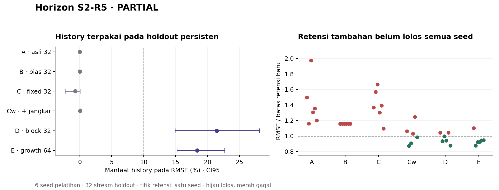
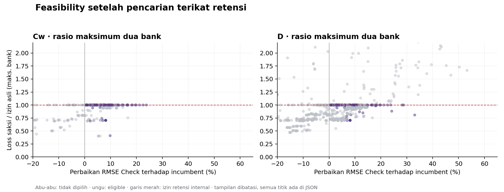

# S2-R5 — Retention-Constrained Native Neural Learning

**Tanggal:** 17 November 2026 (Asia/Jakarta). **Keputusan keseluruhan: PARTIAL — RETENTION LIMITED.**
**Repository:** mpsprintit-spec/horizon-artificial-brain. Branch: `research/s2-r5-retention-constrained-20261117`.
**Main referensi:** `11c6e0a78547d68a0be8f78b3c801e912722608d`. **Basis kode R4:** `0069e6eb27dbe9334746dd80cc31e5ed52214867`.
**Source ilmiah dibekukan:** `2fac4b8e21cf89ae211aac3f8ee7f52473fda4e6`, tree `25f9ecbc4bcdcaf369a192b06572a26f64e384b7`.
Main dan Brain produksi tidak diubah. Tidak ada merge PR #74–#78 dan tidak ada promosi arm.

## 1. Executive scientific verdict

**Tujuan:** mempelajari hubungan baru di N yang sama sambil menjaga pengetahuan lama.
**Implementasi:** solver native opt-in, batas retensi asli, jangkar tambahan terpisah, refinement block-sparse generik, dan kontrol pertumbuhan 64 benar-benar berjalan melalui transaksi native.
**Pengujian:** enam seed, 108 Brain penelitian, 432 kesempatan belajar, holdout baru dan seluruh bukti negatif disimpan.
**Keputusan:** perlu perbaikan. Penggunaan history pada basis 32 telah terukur, tetapi keamanan retensi di seluruh seed belum tercapai.

D32 menurunkan RMSE persisten menjadi 0.07404566 versus 0.09427158 pada kontrol magnitude-masked: manfaat **21.455%, CI95 [14.907%, 28.149%]**. E64 mencapai 0.07293624, manfaat **18.381%, CI95 [15.226%, 22.698%]**. Ini bukan sekadar koreksi bias: intervensi magnitude dan conditional permutation pada model yang sama juga menurunkan kemampuan prediksi.

Keduanya lulus batas historis S2 pada 6/6 seed. Namun holdout retensi normal baru hanya lulus **D 4/6 dan E 5/6**. Mean prediksi persisten D dan E masih kurang dari 80% mean actual. Karena Gate B dan F gagal, **HISTORY LEARNING PASS dan keseluruhan PASS tidak diberikan**. Beberapa seed memiliki update yang berguna dan aman pada seluruh cakupan uji, tetapi memilihnya sebagai penerus kanonik akan melanggar protokol enam-seed.

## 2. Verifikasi sumber Brain

Arsip gabungan R4: 626.908.084 byte, SHA-256 `4d29df0bae3e92e808fd540d6a54d817d8f641c89047e14e19f41103cb83ab0a`; **2.250/2.250 payload terautentikasi**. Arsip R3 di dalamnya juga diautentikasi (653 payload), kemudian arsip R2 (443 payload). SHA R2 `e51b61bf41107f4f74e7d72d6360b22cd4671d0f6ce84e867212090290e0aa46`.

Checkpoint `s2r2/s2r2-continuation.json`, journal lengkap `s2r2/training-combined/events.jsonl`, sequence **80735**, checksum native **`9016b845eed4e8437e87ada99b9641718a086c570e246dd0a62e57dffd1ce9d3`**. Inventory: **274 unit, 6.408 sinaps, 32 fitur, 10.752 native policy updates**.

Native restore, checksum skema, replay historis 80681→80735 dan kesatuan pemilik activation/learning/DNF diperiksa sebelum training. Seluruh 108 arm berasal dari pasangan byte-identik ini. Tidak ada parameter/checkpoint arm R3/R4 yang dipromosikan atau dipakai sebagai sumber. A–E1/S1/S2/R2 tidak dilatih ulang. R4 A32 digunakan hanya untuk audit kalibrasi terhadap data pengembangan, tanpa pemilihan seed terbaik.

## 3. Batas arsitektur persis

Semua hasil masuk ke signed excitatory/inhibitory synapses pada satu Brain/N. Query S2 tetap `[257,258,259,260]`; jumlah head numerik tetap empat. D32 tetap 274 unit dan 32 fitur; E hanya merekrut hingga 35–36 fitur, bukan mengisi 64. Policy operasi tetap dengan 10.752 updates; cakupan penelitian ini adalah readout dan representasi numerik, bukan pelatihan ulang policy umum.

Tidak ada Correction Engine, jaringan kedua, Error-History Engine, model Python runtime atau prioritas history dalam learning law. Matriks solver merupakan workspace sementara. Diagnosis menyimpan kandidat untuk audit tetapi jalur prediksi membaca parameter kanonik dari sinaps, bukan dari kandidat audit. Buffer tiga residual pengalaman adalah adapter yang sama dengan R4, bukan bukti memori temporal otonom baru.

## 4. Audit kontrak retensi aktual

Audit mencakup `neural_metric_learning.go`, `neural_metric.go`, proposal/refinement/support, `neural_resolution.go`, validation, transaksi runtime dan recovery. Rincian matematis lengkap ada pada `RETENTION_CONTRACT.md`.

Untuk witness r: a adalah prediksi incumbent yang sudah di-clip, b prediksi kandidat yang sudah di-clip. Allowance numerik lama adalah `nu=roundoff(a)+Σ |w_lama,j| error_fitur_lama,j`. Kontrak setiap kelompok query melarang `nImproves(mean((|a-y|+nu)^2), mean((b-y)^2))`. `nImproves` menggunakan 16 ulp sesuai kode asli. OutcomeError tidak ditambahkan oleh fungsi regresi ini. Perlindungan pembalikan tanda pada witness biner yang sebelumnya benar dan cukup yakin juga tetap berlaku.

Ini perlindungan loss **kelompok**, bukan batas perubahan prediksi per titik. Unit test menunjukkan suatu titik boleh memburuk ketika loss kelompok membaik dan tidak ada pembalikan keputusan terlarang. Solver tidak mengganti kontrak dengan versi titik-per-titik yang lebih lemah. Retention tolerance, signed bounds dan batas oracle historis tidak dilonggarkan.

26 fitur dilindungi dependensi head lain. Hanya proyeksi leaf **266** yang dapat direfine oleh mekanisme ini; lima fitur S2 lain yang bersifat product tidak direpurpos tanpa protokol perubahan jenis circuit. Tidak ada pemangkasan berdasarkan bobot kecil.

## 5. Diagnosis kalibrasi

Verifikasi deskriptif terpisah atas angka R4 menemukan mean actual **0,1137001454**, mean A32 pooled **0,0320904336**, pada 768 kasus final persisten R4. Pemeriksaan ini dilakukan setelah seluruh model R5 disegel, hanya untuk mengaudit klaim lama. Data tersebut tidak digunakan untuk tuning, training, calibration fitting atau pemilihan checkpoint R5.

Diagnosis awal menggunakan development R4: stream 0–7 Fit, 8–15 Check, 16–23 development holdout. Bias/affine/konstan dilatih hanya pada Fit. Audit baru memakai 128 Fit temporal tiap seed; koefisien kontrol dibekukan sebelum final. Semua koefisien, ID Fit/Check, operasi, residual quantiles, MAE dan calibration error tersedia di `OFFLINE_CALIBRATION_LOCK.json` dan hasil analisis.

Kontrol statistik offline pada holdout persisten baru:

| Model | Kontrol | RMSE | Mean prediksi | Rasio terhadap actual |
|---|---|---|---|---|
| source | affine | 0.07946307 | 0.12363692 | 1.13966 |
| source | bias | 0.07939047 | 0.12422213 | 1.14505 |
| source | constant | 0.08201768 | 0.12540917 | 1.15600 |
| source | original | 0.12734464 | 0.00655042 | 0.06038 |
| A | affine | 0.07841281 | 0.12367905 | 1.14005 |
| A | bias | 0.07779349 | 0.12422864 | 1.14511 |
| A | constant | 0.08201768 | 0.12540917 | 1.15600 |
| A | original | 0.10527709 | 0.03435656 | 0.31669 |

Kontrol offline tidak dipasang ke Brain. Koreksi global yang tampak baik pada distribusi baru dapat merusak S2 lama; seluruh regresi historisnya disimpan, bukan disembunyikan. B native mencari bias yang diizinkan retensi; ia tidak dapat begitu saja menaikkan semua prediksi ke mean baru.

| Arm native | Mean actual | Mean prediksi | Bias | Rasio | MAE | Calibration error |
|---|---|---|---|---|---|---|
| A | 0.10848588 | 0.03435656 | -0.07412931 | 0.31669 | 0.08012679 | 0.07412931 |
| B | 0.10848588 | 0.01271302 | -0.09577286 | 0.11719 | 0.09615798 | 0.09577286 |
| C | 0.10848588 | 0.06022876 | -0.04825711 | 0.55518 | 0.07867383 | 0.04825711 |
| Cw | 0.10848588 | 0.05650465 | -0.05198122 | 0.52085 | 0.07593406 | 0.05198122 |
| D | 0.10848588 | 0.07417870 | -0.03430718 | 0.68376 | 0.05574500 | 0.03432680 |
| E | 0.10848588 | 0.07765827 | -0.03082761 | 0.71584 | 0.05692365 | 0.03088281 |

Target mean-ratio [0,8;1,2] tidak diganti setelah hasil. Semua arm persisten utama gagal target ini. Kalibrasi bukan bukti history learning; manfaat history dihitung terhadap paired masked training dan intervensi pada model yang sama.

## 6. Formulasi constrained update

Pada basis tetap, prediksi adalah `clip(b+w^T phi(x),-1,1)`. Phi diperoleh dari circuit N: proyeksi atau product parent, quantizer `round((raw-center)/delta)`, lalu metric reconstruction atau tanh(code). Mode incumbent S2 tetap metric. Variabel optimasi hanya koreksi bobot/bias current query; graph, center, delta dan head lain tetap pada fase fixed-basis.

Pada region tanpa clipping, loss Fit dan loss saksi adalah quadratic; perlindungan tanda adalah linear terbuka. Secara global clipping memberi fungsi piecewise-quadratic yang tidak selalu convex. Perubahan bin/axis/parent lebih lanjut dapat diskontinu. Karena itu tidak diklaim seluruh masalah adalah QP convex sederhana.

Workspace mencari minimum weighted least-squares terhadap Fit dan loss saksi dalam koordinat koreksi yang diskalakan, dengan signed box [-7,99;7,99]. Penalti saksi sudah masuk saat mencari arah, bukan hanya sesudah full refit. Hasil selanjutnya harus lolos kontrak native penuh, Check, shared guard, precision dan validitas numerik. Dua bank saksi diperiksa **terpisah**; penjumlahan bank tidak boleh menutupi regresi pada bank lama.

## 7. Implementasi solver

Opt-in protocol `retention-constrained-native-v1`, tanpa perubahan jalur historis bila proposal lama/nil. Pencarian memakai 256 sweep cyclic coordinate descent terikat box; ridge 1e-12, stop perubahan 1e-11; multiplier path [0,1e-4,1e-3,0.01,0.1,1,10,100,1e3,1e4,1e5,1e6,1e8]. Nilai fitur diskalakan dari Fit dan saksi, bukan holdout.

Setiap titik ditinjau oleh kontrak clipping/group/sign asli. Bila basis zero-step aman, bisection 40 langkah mencari segmen feasible dari incumbent. Basis struktural dengan zero-step tidak aman tidak memperoleh anggapan feasible palsu. Shared guard tetap memutuskan. Semua kandidat/rejection disimpan.

Koefisien baru dan circuit yang berubah dikuantisasi ke significand dyadic 40 bit **sebelum** evaluasi. Ini memberi headroom untuk penjumlahan 4/16 edge dan exact signed reconstruction. Setelah penulisan, fungsi regresi asli dan shared guard dijalankan lagi, serta prediksi terpasang harus bit-identik dengan kandidat yang dinilai. B mengoptimalkan bias saja; grid juga membulatkan koefisien incumbent dengan perubahan sangat kecil yang dicatat pada delta parameter. Ini bukan penggantian tersembunyi terhadap bobot melalui refit penuh.

Pencarian terbatas ini bukan sertifikat optimum global/KKT atau ketidaklayakan global. Banyak sweep mencapai budget; itu dilaporkan sebagai batas solver. Update nol bukan sukses. Enam kesempatan belajar tidak committed dicatat sebagai tidak ada update bermanfaat yang lolos seluruh admission (`NO_BENEFICIAL_FEASIBLE_UPDATE` pada kesempatan itu), bukan dipaksa masuk.

## 8. Feasibility dan Pareto

`feasibility-pareto.json` menyimpan titik multiplier, loss Fit/Check, loss dan izin bank lama/jangkar, displacement, raw readout sebelum line search, violations awal/akhir, bounds dan jumlah iterasi. Raw proposal yang melanggar tetap evidence. `parameter-deltas.json` memetakan perubahan signed edge, koefisien readout, axis, center dan quantizer ke unit N.

| Arm | Kandidat retensi-feasible | Eligible | Ditolak retensi | Shared change | Tidak membaik Check | Fit/bounds invalid |
|---|---|---|---|---|---|---|
| A | 50 | 50 | 1630 | 1248 | 897 | 0 |
| B | 312 | 36 | 0 | 0 | 276 | 0 |
| C | 312 | 139 | 0 | 0 | 173 | 0 |
| Cw | 312 | 146 | 0 | 0 | 166 | 0 |
| D | 914 | 165 | 646 | 0 | 1185 | 0 |
| E | 1560 | 180 | 0 | 0 | 1380 | 0 |

Alasan bertumpang tindih dan trial tidak independen. Eligible bukan jumlah commit; pemilihan hanya pada Check, tanpa final holdout. Seluruh 426 commit dari 432 kesempatan memiliki **0 kandidat pelanggar retensi internal yang terpasang** menurut receipts dan post-install guards metode baru.

H2 mempunyai bukti terbatas yang nyata: update readout nonzero yang lolos native dapat ditemukan, dan beberapa seed juga mempertahankan kedua holdout eksternal. Namun original witness-feasible tidak menjamin keamanan distribusi lama secara keseluruhan. Pada basis asli, history improvement Cw hanya sekitar 0,03%, jauh di bawah target; kelayakan linear global belum dibuktikan atau dibantah. Fase fixed-basis tidak cukup untuk kemampuan history yang diminta, sehingga diagnosis berlanjut ke representasi sesuai aturan yang didaftarkan sebelumnya.

## 9. Perbandingan baseline dan desain terkontrol

Seed **37,83,151,211,307,419** dibekukan dan tidak diganti. Tiap seed/condition mengakuisisi 16 stream ×16 operasi native; tiap model mendapat empat lesson, masing-masing 32 Fit dan 32 Check dari stream utuh terpisah. Semua salinan seed/condition mereplay observasi byte-identik sebelum learning. Checkpoint final selalu lesson 4; tidak ada pemilihan berdasarkan holdout.

Jam logis mengikuti kontrol R4: tick simulasi 1 ns/event untuk menahan confound passive ageing; waktu komputasi wall diukur terpisah. Ini cakupan retensi pada jam eksperimen yang dikendalikan, bukan pengujian forgetting selama hari-hari pemakaian nyata.

A=learner R4 asli 32; B=bias constrained; C=fixed-basis constrained; Cw=C+64 jangkar lama; D=block-sparse leaf refinement constrained 32+jangkar; E=block-sparse controlled growth ceiling64+jangkar. Sufiks 0 memask tiga magnitude saja. Sufiks I berarti pelatihan IID; pasangan IID tersedia untuk A,D,E. Presence/history-operation/current context tetap sama pada semua mask.

Final baru: seed 8100017/8200031/8300043 (persistent/IID/shifted), 32×24 kasus tiap kondisi. Retensi tambahan: seed 8900003/9000007, normal/shifted, 128 kasus tiap kondisi. 1182 berkas kode/config/model disegel sebelum akuisisi pertama. Tidak ada refit, threshold change atau rerun pemilihan sesudah final.

| Arm | RMSE history | RMSE masked | Manfaat history | CI95 | Historis /6 | Normal baru /6 | Shift baru /6 |
|---|---|---|---|---|---|---|---|
| A | 0.10527709 | 0.10526727 | -0.009% | [-0.011%, -0.007%] | 2 | 0 | 4 |
| B | 0.12246739 | 0.12244969 | -0.014% | [-0.015%, -0.014%] | 6 | 0 | 6 |
| C | 0.09476578 | 0.09407806 | -0.731% | [-2.313%, 0.039%] | 5 | 0 | 5 |
| Cw | 0.09315852 | 0.09318651 | 0.030% | [0.022%, 0.036%] | 6 | 3 | 6 |
| D | 0.07404566 | 0.09427158 | 21.455% | [14.907%, 28.149%] | 6 | 4 | 6 |
| E | 0.07293624 | 0.08936193 | 18.381% | [15.226%, 22.698%] | 6 | 5 | 6 |

## 10. Native learning receipts

Total **426/432** native committed lessons, dari 21072 trial kandidat. B/C/Cw/D/E menggunakan protokol baru yang dijournal, A mempertahankan learner lama. Komposisi hasil belajar disimpan sebagai signed parameters, bukan prediksi yang ditempelkan. Query/head count tidak bertambah. Jumlah commit bukan bukti kemampuan: pembaruan bias yang sangat kecil ketika constraint aktif tidak dihitung sebagai keberhasilan kalibrasi atau history learning.

`receipts.json`, `costs.json`, Fit/Check per block dan full `events.jsonl` ada untuk setiap model. Raw candidate, axis/parent, λ, bounds, semua rejection dan delta parameter dipertahankan. Dataset pre-operation lengkap berjumlah **6.144 observasi temporal** (development 768, training 3.072, final 2.304), ditambah 64 jangkar dan 256 pengalaman retensi tambahan. Pengulangan penggunaan pengalaman antar-arm tidak dihitung sebagai pengalaman unik baru.

## 11. Retensi historis

Source RMSE historis **0,01682331**; batas fixed **0,01766457**. Batas ini tidak diubah. D/E full-history masing-masing lulus 6/6; A hanya 2/6, C 5/6. Witness asli tetap identik pada 108/108 model dan native policy tetap identik pada 108/108.

A–E1: **108/108** lulus seluruh oracle historis; delta maksimum 4.93294294301e-12, E1 delta maksimum 4.93294294301e-12, keduanya dibanding batas asli 1e-7. S1: strict prediction shift **0** pada 108/108 model di cakupan historis, retensi baru dan seluruh final input. Sukses oracle bukan klaim generalisasi di luar cakupan yang diuji.

## 12. Retensi baru yang independen

Normal baru source RMSE **0.00956880**, batas **0.01004734** (nilai persis disimpan dalam JSON, keputusan memakai nilai non-rounded). Shifted source **0.02119322**, batas **0.02225298**. Aturan source×1,05+1e-7 dibekukan sebelum akuisisi. Angka di tabel dibulatkan untuk tampilan, bukan dipakai untuk admission.

| Seed | D historis | D normal baru | D shifted baru | E historis | E normal baru | E shifted baru |
|---|---|---|---|---|---|---|
| 37 | 0.01382146 | 0.01046691 | 0.01675502 | 0.01366186 | 0.01105781 | 0.01698964 |
| 83 | 0.01247828 | 0.00937212 | 0.01553456 | 0.01109194 | 0.00877973 | 0.01506004 |
| 151 | 0.01258610 | 0.01000862 | 0.01453748 | 0.01138359 | 0.00927487 | 0.01314977 |
| 211 | 0.01301659 | 0.00945408 | 0.01605268 | 0.01258916 | 0.00928412 | 0.01602313 |
| 307 | 0.01339541 | 0.01047239 | 0.01600353 | 0.01170304 | 0.00947786 | 0.01424326 |
| 419 | 0.01180966 | 0.00879153 | 0.01488383 | 0.01170476 | 0.00952243 | 0.01602573 |

D gagal normal baru seed 37 dan 307; E gagal seed 37. Semua enam seed D/E lulus shifted tambahan. Kegagalan kecil sekalipun tetap FAIL; tidak ada pengecualian atau promosi seed yang lebih baik. Retensi historis saja tidak cukup untuk Gate F.

## 13. Atribusi informasi error-history

R4 terverifikasi menunjukkan informasi kondisional offline 25,01844% (CI95 19,28215–30,53301) pada distribusinya. Angka ini bukan kemampuan native atau optimum/oracle untuk data R5 yang berbeda.

| Arm | Ablation RMSE benefit | CI95 ablation | Conditional permutation benefit | CI95 permutation | Prediksi berubah | Maks. perubahan |
|---|---|---|---|---|---|---|
| D | 30.702% | [22.189%, 38.293%] | 18.489% | [11.443%, 26.051%] | 4416 | 0.16261730 |
| E | 26.670% | [20.355%, 34.011%] | 16.336% | [10.648%, 23.827%] | 4416 | 0.14291426 |

D memakai kembali **unit 266** sebagai proyeksi block generik yang kini langsung memakai koordinat magnitude 59–61; semua enam seed demikian. E mempertahankan fitur 266 lama dan merekrut history-bearing unit **275**, dengan peta sumber/sinaps lengkap. Tidak ada nama history dalam ranking/learning law. Kontribusi neural, unit intervention dan activation/metric/code/uncertainty disimpan dalam feature traces.

Magnitude ablation dapat mengubah distribusi input; karena itu tidak berdiri sendiri. Conditional donor matching memakai 48 dimensi current/previous state dan forecast, konteks operasi/presence yang sama, dan donor stream lain. Matching nearest-neighbor bersifat **aproksimasi**, bukan exchangeability exact atau bukti kausal universal. Donor self pada boundary tanpa history menjaga input tetap identik. Jarak match dilaporkan. Paired trained control, actual-operation provenance dan semua intervensi bersama-sama mendukung penggunaan history pada distribusi persisten.

## 14. Eksperimen block-sparse

Pengembangan menjalankan full-dimensional leaf direction dengan fitter asli, block-sparse dengan fitter asli, block-sparse+constrained, dan zero-variance negative block. Full32 dan Block32 fitter asli berakhir sama pada development RMSE 0,10558792; proposal struktural tidak terpilih. D development 0,09898258 versus D0 0,09868480 tidak memberi manfaat history. Hasil negatif ini tetap ada, bukan diganti dengan final yang lebih baik.

Fase confirmatory pada pengalaman seed berbeda memberi gain D yang kuat. Ini menunjukkan variasi pencarian/stream penting; tidak ada pemilihan checkpoint terbaik dari final. Block search membagi setiap row tujuh-koordinat menjadi dua triplet generik, meranking hanya residual Fit dan mencoba empat arah teratas. Hanya leaf aman dapat berubah. Zero block [65,66,67] tidak mempunyai variance dan tidak melahirkan arah baru; ia kontrol degenerat, bukan uji menyeluruh pada distractor bervariasi. Kontrol temporal IID yang terpisah menilai efek praktis palsu.

Tanh(code) banyak tersaturasi, tetapi S2 membaca metric reconstruction. Saturasi activation saja tidak membuktikan hilangnya seluruh informasi. Perubahan akses metric dan kontribusi prediktif menjadi bukti yang lebih relevan.

## 15. Capacity ablation

D tetap 32 fitur dan sudah melewati gate prediktif history. E berkembang menjadi 35–36. E dibanding D memberi tambahan RMSE improvement **1.498%, CI95 [-7.710%, 9.253%]**. Dengan CI melintasi nol, **keunggulan kapasitas tambahan belum terbukti**. Ceiling64 tidak menjadi default dan tidak diperlukan untuk menunjukkan manfaat history yang terukur di eksperimen ini.

A/C/Cw/D/E memiliki jumlah pengalaman, empat kesempatan belajar dan final stopping yang sama. Cw/D/E juga memiliki jangkar/retention gates yang sama. Jumlah kandidat memang berbeda akibat pencarian representasi; biaya dan jumlahnya dilaporkan, bukan disetarakan secara palsu. Safe slot deletion/reuse jenis product tidak diimplementasikan tanpa sertifikat dependensi/fungsi/persistence. Refinement D mempertahankan ID dan anggaran fitur, tetapi tidak dianggap pruning.

## 16. Generalisasi

| Arm | Persistent RMSE | IID RMSE | Shifted RMSE |
|---|---|---|---|
| A | 0.10527709 | 0.09959177 | 0.08685333 |
| Cw | 0.09315852 | 0.08851947 | 0.07704439 |
| D | 0.07404566 | 0.08754151 | 0.06190859 |
| D0 | 0.09427158 | 0.08942045 | 0.07775552 |
| E | 0.07293624 | 0.08414020 | 0.06085059 |
| E0 | 0.08936193 | 0.08518043 | 0.07376733 |
| AI | 0.10947902 | 0.10329454 | 0.09067498 |
| DI | 0.08481869 | 0.08173804 | 0.07153304 |
| EI | 0.07847565 | 0.07850574 | 0.06835573 |

D shifted-history improvement 20.380%, CI95 [14.236%, 26.530%]; E 17.510%, CI95 [14.648%, 21.030%]. Seluruh per-seed/per-stream/operation metrics, residual distribution dan kalibrasi tersedia, termasuk seed dengan hasil buruk.

## 17. Negative controls

Margin equivalence IID dibekukan pada ±3%; syarat CI90 seluruhnya di dalam margin. Tidak cukup hanya interval yang memotong nol.

| Arm IID-trained | Efek paired | CI90 | CI95 | Equivalence | Ablation | Permutation |
|---|---|---|---|---|---|---|
| AI | -0.008% | [-0.008%, -0.007%] | [-0.008%, -0.007%] | PASS | -0.005% | -0.000% |
| DI | 1.179% | [0.038%, 2.455%] | [0.001%, 2.835%] | PASS | 0.003% | 0.000% |
| EI | -0.134% | [-0.842%, 0.526%] | [-1.011%, 0.712%] | PASS | 1.480% | 0.036% |

DI mempunyai efek paired kecil yang CI95-nya sedikit positif; ini **tidak disembunyikan sebagai nol statistik**. Namun CI90 masih di dalam margin praktis yang didaftarkan, dan intervensi history hampir tidak mengubah loss. EI juga memenuhi equivalence. Model persistent yang diuji pada IID berbeda dari model yang dilatih IID: ablation-nya bisa besar karena history di-mask keluar dari distribusi, sedangkan conditional permutation IID jauh lebih kecil. Semua versi tetap dilaporkan.

Audit provenance memeriksa actual poststate→target, urutan history, prior operation, ledger sebelum operasi, checksum input, batas stream dan konteks donor: **0 kesalahan pada 6.144 observasi temporal**. Hidden gain/regime ada hanya di evidence lingkungan/WAL; tidak ada dalam input N atau label yang diberikan sebelum operasi.

## 18. Stabilitas numerik

Semua proposal memakai signed bounds asli. Grid 40 bit memperbaiki kegagalan averaging yang diungkap pada development awal. Shared feature graph lama tetap dilindungi. Baseline A mempertahankan writer historis; metode baru mengecek hasil setelah kuantisasi/penulisan. Unit test meliputi arah feasible nonzero, kasus tanpa update bermanfaat, sifat grouped retention dan exact reconstruction populasi.

| Arm | Total sweep solver | Evaluasi feasible-segment | Aktivitas signed bound |
|---|---|---|---|
| B | 624 | 6360 | 0 |
| C | 79872 | 6760 | 0 |
| Cw | 79872 | 7080 | 0 |
| D | 399360 | 11240 | 0 |
| E | 399360 | 36680 | 0 |

Banyak subproblem berhenti pada budget sweep, sehingga tidak ada klaim solusi optimal penuh. Raw arah yang terhalang, numerical invalidity/bounds dan semua rejected candidates disimpan. Pencarian finite yang tidak berhasil tidak dipakai sebagai bukti matematis bahwa seluruh ruang readout mustahil.

## 19. Biaya sumber daya

| Arm | Commit /24 | Trial | Median 4-command learning (s) | Median p50 (ms) | Median p95 (ms) | Fitur aktual |
|---|---|---|---|---|---|---|
| A | 24 | 1680 | 4.746 | 0.1569 | 0.3219 | 32 |
| B | 24 | 312 | 2.389 | 0.1513 | 0.2907 | 32 |
| C | 23 | 312 | 2.321 | 0.1601 | 0.3046 | 32 |
| Cw | 24 | 312 | 3.639 | 0.1669 | 0.2932 | 32 |
| D | 23 | 1560 | 19.913 | 0.1661 | 0.3027 | 32 |
| E | 23 | 1560 | 34.304 | 0.1990 | 0.3319 | 35,36 |

Angka training di tabel hanya biaya learning transaction; keseluruhan acquisition+fork/replay+18 arm memerlukan sekitar 432–435 detik per seed pada jadwal asli tiga proses, GOMAXPROCS=2/proses. Jangan menyamakan keduanya. Peak RSS evaluasi tercatat hingga 192.4 MiB per proses; allocations, heap, checkpoint byte size dan full WAL growth ada untuk seluruh 108 model.

Median checkpoint-only recovery 0.7490 s; median full-suffix replay 8.5605 s. Latensi diukur di desktop bersama proses lain, bukan benchmark CPU terisolasi. R4 A32 melaporkan p50 sekitar 0,139 ms/p95 0,275 ms pada kondisinya; perbedaan host/load/protokol membatasi perbandingan langsung. A R5 adalah kontrol learner R4 pada host yang sama. D/E meningkatkan biaya training; ceiling64 tidak menunjukkan superioritas prediktif yang meyakinkan.

Build Go seluruh paket, vet, seluruh test default, tagged metric/native regressions dan targeted race knowledge/runtime lulus. Biner Android arm64 untuk service AI dan horizon-chat terbangun. **Tidak ada klaim peningkatan kecepatan Android**; perangkat Android fisik tidak dibenchmark. Exact replay diukur pada amd64, bukan dibuktikan lintas arsitektur melalui cross-build saja. Race invocation awal tidak memilih test runtime karena regex, tercatat sebagai no-tests dan diperbaiki dengan invocation terarah yang benar; tidak dihitung sebagai runtime coverage.

## 20. Persistence dan exact replay

**108/108** restart predictions exact, canonical Brain/state exact, replay seluruh suffix dari 80735 exact, prefix WAL historis utuh, rollback sumber exact. Reconstructed signed parameters berada pada N yang sama dan proposal protocol tersimpan pada journal. Hasil checkpoint/restart dibandingkan sebelum keputusan kemampuan.

Dua bank retensi dan pengaturan solver ikut pada exposure/WAL. Tidak ada journal trimming, transplant parameter atau state model lain. Original source tetap immutable. Detached oracle image membuang hanya metadata dedup adapter, mempertahankan Brain/sequence; tidak pernah dipakai untuk melanjutkan training.

Semua checkpoint final, full historical+new WAL, observer checkpoints, ledgers, poststates, traces, masks, configuration/source hashes, per-stream metrics, deltas dan bukti negatif disertakan pada arsip autentikasi. `RESTORE.md` menjelaskan recovery/reproduksi, `BUNDLE.json` mengikat source/Brain dan `MANIFEST.json` mengautentikasi payload. Instruksi unduh dan hash luar dipublikasikan pada `ARTIFACT.md` dan dokumen pemulihan pemilik setelah verifikasi unduh ulang.

## 21. Eksperimen gagal dan batas

1. Development awal terhenti pada B: exact post-install guard menemukan perbedaan ulp akibat averaging. A telah menyelesaikan empat lesson; semua WAL dan log dipertahankan. Perbaikan grid dilakukan sebelum training confirmatory/final, lalu development v2 berasal lagi dari R2, bukan checkpoint A yang dipilih.
2. Fixed-basis C development membaik ke 0,09169512 tetapi retensi historis menjadi 0,02404367 (FAIL). Menambahkan coverage Cw menurunkannya menjadi 0,01222804 pada development; tidak dianggap jaminan semua distribusi.
3. D development tidak memberi manfaat history; E development hanya sekitar 6,04% terhadap E0. Semua model dan data pengembangan negatif tetap disimpan.
4. Pada final, retensi tambahan dan mean calibration tetap gagal. Tidak ada perbaikan sesudah melihat final, pemilihan ulang seed, penggunaan final R4 untuk tuning, pelonggaran batas, atau percobaan final baru untuk mengganti hasil negatif.
5. Zero-block bersifat degenerat; solver tidak memberi sertifikat global; interval berasal dari enam seed/32 stream, bukan ribuan trial independen. Nearest conditional match aproksimatif. Buffer pengalaman bukan kemampuan recovery temporal otonom. Tidak ada generalisasi luas di luar kondisi yang diuji.

## 22. Keputusan ilmiah per hipotesis dan gate

| Hipotesis | Kesimpulan yang didukung |
|---|---|
| H1 calibration limitation | Bias skala besar benar pada distribusi tertentu. Koreksi offline membantu tetapi dapat merusak kemampuan lama; tidak cukup untuk menyatakan native history berhasil. |
| H2 constrained optimization | Pencarian feasible nonzero dan commit native terbukti; beberapa seed aman secara eksternal. Robustness lintas seluruh seed belum lulus. Tidak boleh menganggap semua proposal R4 yang ditolak seharusnya diterima. |
| H3 fixed representation | Basis asli dengan constrained readout belum mencapai target history. Ini keterbatasan metode/basis yang diuji, bukan sertifikat tidak adanya seluruh arah feasible. |
| H4 structural plasticity | Didukung: D menggunakan jumlah fitur tetap 32 tetapi akses history menjadi berguna secara independen. E64 tidak terbukti lebih baik daripada D. |
| H5 witness coverage | Didukung: C→Cw memperbaiki retensi, tetapi holdout baru tetap menemukan regresi. Bank terbatas bukan jaminan perlindungan distribusi lama. |

| Gate | Keputusan |
|---|---|
| A Source integrity | PASS: exact R2, replay/checksum, sumber tidak diubah. |
| B Calibration | FAIL untuk seluruh arm persisten utama terhadap mean-ratio yang dibekukan. |
| C Constrained learning | Mekanisme/native admission berjalan, zero installed internal violation; keselamatan eksternal universal lintas seed belum PASS. |
| D History predictive | PASS metrik prediktif D dan E; gain ≥10%, CI95 positif, ablation/permutation/neural attribution mendukung. |
| E IID negative control | PASS equivalence praktis pasangan IID D/E dalam ±3%; efek kecil/statistik tetap dilaporkan. |
| F Retention | FAIL keseluruhan: D 4/6, E 5/6 pada holdout tambahan normal; strict S1 dan A–E1 lulus cakupan uji. |
| G Persistence | PASS 108/108 exact proofs dan full WAL. |
| H Reproducibility | PASS pada cakupan enam seed, semua arm/evidence, build/vet/test/race/arm64 dan recovery archive yang disediakan. |

**Status: PARTIAL — RETENTION LIMITED.** History-learning capability terukur pada distribusi yang diuji, tetapi label **HISTORY LEARNING PASS belum diberikan** karena Gate F dan B gagal. **CONSTRAINED UPDATE PASS lintas seluruh seed belum diberikan**. Tidak ada BLOCKED integritas sumber; kesimpulan negatif adalah hasil penelitian yang sah, bukan error yang disembunyikan.

Seluruh arm, termasuk kontrol masked dan IID:

| Arm | Persistent test RMSE | Commit /24 | Historis /6 | Normal baru /6 | Shifted baru /6 | S1+S2 seluruh retensi /6 |
|---|---|---|---|---|---|---|
| A | 0.10527709 | 24 | 2 | 0 | 4 | 0 |
| A0 | 0.10526727 | 24 | 2 | 0 | 4 | 0 |
| B | 0.12246739 | 24 | 6 | 0 | 6 | 0 |
| B0 | 0.12244969 | 24 | 6 | 0 | 6 | 0 |
| C | 0.09476578 | 23 | 5 | 0 | 5 | 0 |
| C0 | 0.09407806 | 23 | 5 | 0 | 5 | 0 |
| Cw | 0.09315852 | 24 | 6 | 3 | 6 | 3 |
| Cw0 | 0.09318651 | 24 | 6 | 3 | 6 | 3 |
| D | 0.07404566 | 23 | 6 | 4 | 6 | 4 |
| D0 | 0.09427158 | 24 | 6 | 3 | 6 | 3 |
| E | 0.07293624 | 23 | 6 | 5 | 6 | 5 |
| E0 | 0.08936193 | 24 | 6 | 2 | 5 | 2 |
| AI | 0.10947902 | 24 | 5 | 1 | 6 | 1 |
| AI0 | 0.10946772 | 24 | 5 | 1 | 6 | 1 |
| DI | 0.08481869 | 24 | 4 | 1 | 4 | 0 |
| DI0 | 0.08613467 | 24 | 3 | 2 | 3 | 1 |
| EI | 0.07847565 | 23 | 4 | 2 | 1 | 0 |
| EI0 | 0.08061239 | 23 | 3 | 2 | 2 | 0 |

## 23. Langkah berikutnya

Prioritaskan coverage retensi dan kalibrasi kontekstual generik, bukan langsung memperbesar kapasitas. D32 sudah menunjukkan bahwa history dapat dipelajari tanpa head/Brain kedua. Uji bank jangkar dengan cakupan state/dependency/operation/error-boundary yang lebih baik dari **development baru** dan constraint per kelompok yang mempertahankan bank lama secara terpisah. Uji optimizer multi-constraint yang lebih lengkap bila finite multiplier path masih membatasi solusi; tetap gunakan evaluator asli sesudah kuantisasi.

Kegagalan normal baru seed 37/307 menjadi diagnosis, bukan data fitting ulang atau alasan mengubah batas R5. Penelitian berikutnya harus membuat protokol, data development dan final baru; seluruh Brain tetap berawal dari lineage yang disepakati tanpa memilih arm final terbaik. Jangan mempromosikan hasil R5 ke main. Arsip ini mempertahankan seluruh hasil agar perbaikan berikutnya dapat diuji, bukan diasumsikan.
