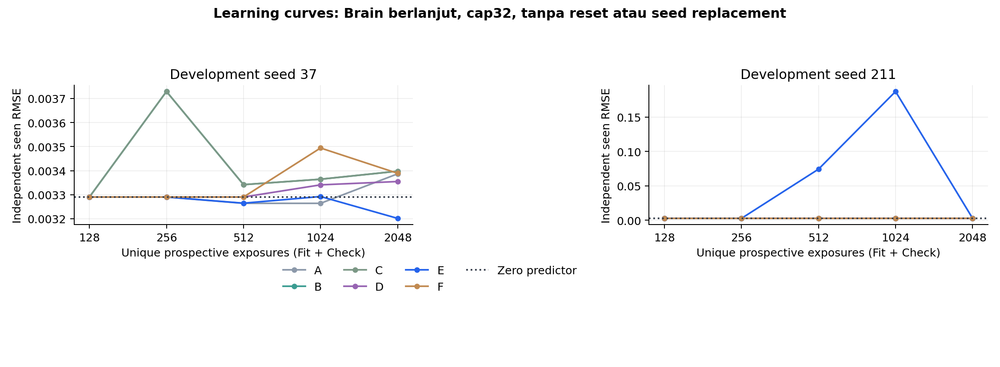
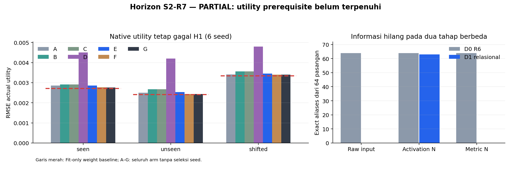

# S2-R7 — Native Neural Utility, Information Sufficiency & Learning Repair

**18 November 2026 — Verdict: PARTIAL. H1 NATIVE UTILITY PREREQUISITE NOT MET.**

Repository `mpsprintit-spec/horizon-artificial-brain`; branch `research/s2-r7-native-utility-information-repair-20261118`. Main dan Brain produksi tidak diubah. Tidak ada merge PR #80, promosi checkpoint terbaik, atau kenaikan cap 32 fitur.

## 1. Executive scientific verdict

Tujuan: membentuk prediksi manfaat perubahan neural dari pengalaman aktual pada N. Implementasi: descriptor relasional, ledger forecast sebelum operasi, curriculum, dan fitter native V3 sudah berjalan. Pengujian: seluruh enam seed dipertahankan; semua arm gagal H1 terhadap pembanding Fit-only. Keputusan: **perlu perbaikan**. Langkah berikutnya: akses dan komposisi relasional native untuk kontribusi deterministik U1, disertai perbaikan perlindungan fungsi lama, sebelum prospective utility dibuka lebih jauh.

Dua kehilangan informasi terbukti: **64/64 raw mean aliases** dan **63/64 activation aliases** setelah raw descriptor diperbaiki. Conditional uncertainty juga nyata pada 32 pasangan prestate identik. Defect perpindahan koefisien metric→activation direproduksi pada development baru seed 211. Perbaikan conditioning tidak menjadi keberhasilan utility. Exact persistence lulus **60/60**; A–E1 lulus **60/60** dengan control revision/time sesuai prosedur R6. Audit awal yang tidak menyamakan revision menghasilkan 0/60 dan dipertahankan sebagai diagnosis measurement confound. Retensi normal baru tetap gagal pada satu seed. H2/H3 NOT RUN; consolidation NOT PROVEN.

| Condition | Native E RMSE | Best legal baseline | Baseline RMSE | Gain E | Macro-F1 E |
|---|---|---|---|---|---|
| seen | 0.00285567 | weight_only | 0.00272208 | -4.908% | 0.3370 |
| unseen | 0.00253722 | weight_only | 0.00241220 | -5.183% | 0.3135 |
| shifted | 0.00345720 | weight_only | 0.00335108 | -3.167% | 0.3086 |

## 2. Source verification

| Item | Verified value |
|---|---|
| Main baseline | 11c6e0a78547d68a0be8f78b3c801e912722608d |
| Code parent R6 | a902b06fc87652858049f12b7e05cbf471fb74d2 |
| R6 scientific local/tree | c068d827b1b8c2cd6edb701b8e9b16dc747ea120 / 6f09340835532cda247495d0550a7a6af55d48ac |
| R7 frozen local source | 5e83ebfe85208ff1d2b82e37a137cdbad10369cc |
| R7 published source, exact tree | 4b15d7b11c58633b5f7716aa8b1c23ae8fb919b7 / 7b3cb56f239475dc9d5eab7d753775c2f52e1fd3 |
| Brain sequence / native checksum | 80735 / 9016b845eed4e8437e87ada99b9641718a086c570e246dd0a62e57dffd1ce9d3 |
| Checkpoint SHA256 | 445991d177dc955ec58e7f9a3244a3f27da98fb90de584b09d4cc05c5c82d29d |
| Historical WAL SHA256 | 05659f8f3ea4bbe29fbcdd90a4f1c00ee8fbbe488234ee4af762730926c083d8 |
| Units / synapses / features / policy updates | 274 / 6408 / 32 / 10752 |

R6 combined archive: 1,590,405,149 bytes, SHA256 `059fa4665ef3f1b5822801c212f27b9494d9b806d0ccb0892c62465cff89cf0c`; seluruh 1,914 payload diautentikasi dengan stream verification. R6 scientific published tree diverifikasi identik dengan local tree yang diberikan. Source R2 dipulihkan dan native suffix 80681→80735 direplay exact. R6 final hanya diagnosis; tidak ada R6 checkpoint yang dipilih sebagai parent training. Lineage: Canonical A–E1 → S1 → S2 → S2-R2 → S2-R7. D32 dibentuk ulang pada pengalaman RNG baru; anchor R7 berada dalam `history-contract/`, terpisah dari anchor source-verification lama.

## 3. Utility target information analysis

Label faktual adalah $U=[(y-p)^2-(y-p\prime)^2]/4$. Dengan $d=p\prime-p$, $U=[2(y-p)d-d^2]/4$. Bila informasi praintervensi $F$ menentukan $p,d$, maka $\mathrm{Var}(U\mid F)=d^2\mathrm{Var}(y\mid F)/4$. Hasil aktual yang belum diketahui tidak otomatis tersedia dari activity/weight.

Seluruh 32 twin memiliki prestate penuh dan encoded input identik, tetapi gain tersembunyi .10 versus .97 memberikan utility berbeda. Untuk **mixture diagnostik dua gain ini**, rata-rata conditional variance 1.11005709548e-07, RMSE floor 0.00033318, fraksi within-context variance 8.255%. Angka tersebut bukan estimasi noise floor seluruh R7. Model probes memberi empirical predictability pada keluarga yang diuji, bukan Bayes-optimal decomposition atau bukti matematis bahwa informasi lain tidak dapat membantu.

## 4. Retrospective versus prospective utility

Prospective query 4 hanya menerima data sebelum operasi; semua input/forecast di-fsync sebelum factual native Step, dengan `BeforeSequence < OperationSequence` untuk setiap row. Retrospective query 5 menerima actual error y setelah operasi, tanpa menerima U sebagai input. Contribution query 6 mempelajari actual prediction change/2 sebagai target terpisah. Label U dihitung sesudah paired native forwards; tidak ada formula utility atau activity×delta di codec native. Analytical identity yang memperoleh y dan p′ adalah post-outcome diagnostic dan tidak dihitung sebagai learned prediction.

Auxiliary contribution dan retrospective masing-masing 128 pengalaman berbeda per D/E/F. Keduanya belum memperlihatkan reliable functional learning: lihat raw auxiliary forecasts pada `final/.../ablation-*.json`. Pemberian y sesudah operasi tidak membuktikan retrospective utility apabila inference pada pengalaman baru gagal. Tidak ada label U yang dibaca saat inference.

## 5. Raw descriptor aliasing

Pada 64 operasi nyata, dua signed delta dipertukarkan di pathway yang sama. Descriptor mean R6 tetap persis sama, sementara actual utility berbeda pada seluruh pasangan. D1 mempertahankan tuple lokal dan membedakan 64/64 pasangan. Ini controlled actual-intervention evidence, bukan contoh angka sintetis yang dihitung sebagai hasil neural.

## 6. Neural activation aliasing

| Descriptor | Raw input aliases /64 | Activation aliases /64 | Metric aliases /64 |
|---|---|---|---|
| D0 | 64 | 64 | 64 |
| D1 | 0 | 63 | 0 |
| D2 | 0 | 63 | 0 |
| D3 | 0 | 63 | 0 |

D1 menghilangkan alias input tetapi 63/64 pasangan masih masuk activation yang sama. Informasi lokal yang berbeda tidak dapat dipisahkan readout activation pada kasus tersebut. Audit random independent holdout, exact float64 dan approximate grid 1e-7/1e-5/1e-3 beserta variance label per collision disimpan lengkap. Grid diagnosis tidak disamakan dengan actual native quantizer.

## 7. Metric representation aliasing

Metric membedakan semua controlled D1 pairs. Tidak adanya exact metric collision pada sampel terbatas tidak membuktikan functional sufficiency untuk linear readout. Offline ridge/polynomial probes dan natively learned readout tetap harus digeneralisasikan. Pada D2/D3/D4, tambahan konteks belum mengubah native representations pada corpus ini karena koordinat yang ditambahkan tidak diakses basis yang sedang digunakan.

## 8. Relation-preserving experience design

D1 menggunakan paling banyak empat local pathway records, setiap record memuat signed metric value, activation, weight, proposed effective delta, eligibility, parent measurements dan fanout. Whole records disortir secara konsisten; measurements di dalam record tidak dirata-ratakan antar pathway. Pathway/neuron IDs tidak masuk tensor. D2 menambahkan original pre-operation sequence dengan history magnitude masked, D3 mengembalikan history kausal, D4 menambahkan 36 observed neurons sebagai diagnosis. D4 tidak dipasang sebagai default produksi. Existing six-channel sequence dan native composition tetap digunakan; tidak ada encoder network kedua.

Permutation consistency lulus pada seluruh final inputs. Seluruh intervensi dari satu origin serta seluruh operasi satu stream berada pada split yang sama. Novel magnitudes .035/.11, withheld pathways (ordinal mod3=0), kombinasi baru dan shifted neural states diuji. Ordinal dipakai hanya untuk spesifikasi intervensi/audit split, bukan inference shortcut.

## 9. Context and history sufficiency

| Seed | D | Raw ridge RMSE | Activation ridge RMSE | Metric ridge RMSE |
|---|---|---|---|---|
| 211 | D0 | 0.00252864 | 0.00257282 | 0.00254713 |
| 211 | D1 | 0.00247835 | 0.00254081 | 0.00252136 |
| 211 | D2 | 0.00249409 | 0.00254081 | 0.00252136 |
| 211 | D3 | 0.00249649 | 0.00254081 | 0.00252136 |
| 211 | D4 | 0.00249730 | 0.00254081 | 0.00252136 |
| 37 | D0 | 0.00319500 | 0.00321025 | 0.00319022 |
| 37 | D1 | 0.00313464 | 0.00317434 | 0.00313961 |
| 37 | D2 | 0.00314970 | 0.00317434 | 0.00313961 |
| 37 | D3 | 0.00315080 | 0.00317434 | 0.00313961 |
| 37 | D4 | 0.00315156 | 0.00317434 | 0.00313961 |

Semua probe dilatih pada Fit origins saja. Constant/zero, activation-only, weight-only, bounded raw linear, regularized raw/activation/metric dan polynomial degree2/3 probes dilaporkan, termasuk kegagalan nonlinear probes. D3 dipilih untuk konteks kausal dalam native-performance tie; superioritas D3 terhadap D1 tidak diklaim. Adding coordinates tidak otomatis memperbaiki akses representasi. Native cap tetap32; tidak ada kesimpulan mathematical capacity insufficiency.

## 10. Native learning diagnosis

Generic opt-in `native-shared-basis-regularized-v3` memfit readout per mode dengan Fit-only centering/scaling, ridge .01, signed bounds7.99 dan dyadic reconstruction. Hasil hanya dipasang lewat original Check, shared protection, retention dan signed writer. Parameter pengetahuan tersimpan pada synapses N. Normalization/model workspaces tidak menjadi persistent predictor. Legacy V1/V2 mempertahankan semantik replay semula.

Basis tetap32 dan seluruh task-local leaf untuk query baru terpakai/terlindungi; current fixed-basis readout belum membentuk komposisi fungsional yang diperlukan. Banyak candidate ditolak karena alias/no-Check-improvement. Rejection tidak diartikan sebagai learned low utility. Original witness capacity sudah terisi; hal ini juga membatasi penyimpanan utility witnesses baru. Semua receipts, rejected candidates, coefficient traces dan full WAL dipertahankan.

## 11. Seed211 failure investigation

R6 seed211 memakai metric readout setelah block1, lalu activation setelah block2 dengan koefisien mencapai7.99. Fit basis activation rank-deficient dan collision-heavy; Check improvement tidak mencegah unseen RMSE .06015717. Offline probe pada R6 memakai original Fit saja, tidak memfit ke final. Final seed211 tidak dibuang.

| Fresh dev seed/block | Warm activation RMSE | Zero-init RMSE | Ridge RMSE | Both Check stages improve |
|---|---|---|---|---|
| 211/3 | 0.07576742 | 0.00222328 | 0.00221913 | True |

Controlled workspace intervention mengisolasi transfer koefisien dari metric ke activation dengan skala berbeda. Koefisien lama dapat menghasilkan large cancellation pada finite fitting dan error baru yang besar meskipun Check membaik. Independently initialized fitting memperbaiki mekanisme tersebut pada development. Semua32 workspace, termasuk yang tidak Check-admissible dan yang tidak membaik, disimpan. Workspace tidak diinstal; hasil ini bukan H1 PASS dan tidak menghilangkan seluruh masalah generalisasi.

## 12. Curriculum learning and measured categories

U1 actual contribution, U2 signed/zero perturbations, U3 context variation, U4 pairs, U5 retrospective outcome dan U6 prospective recorded forecasts dicoba. U7 mengevaluasi transfer. D/E/F memiliki auxiliary budget sama; E mengurutkan utility corpus berdasarkan complexity stages, D memakai randomized origin order. Development V1 auxiliary order dan final ordered variant dibedakan; two-seed controlled order proof menunjukkan prospective forecasts exact pada512 exposures. Tidak ada Brain reset antar lesson. Kegagalan prasyarat dipertahankan; urutan ini tidak dinyatakan sudah berhasil sebagai kemampuan.

| Factual condition | Dev37 count | Dev211 count |
|---|---|---|
| A | 615 | 609 |
| B | 0 | 0 |
| C | 119 | 132 |
| D | 151 | 123 |
| E | 1 | 0 |
| F | 30 | 17 |
| G | 128 | 117 |
| H | 615 | 609 |

A: activity≥.9 tetapi |U|≤1e-5; B: activity≤.1 tetapi |U|>1e-5 (tidak ditemukan); C/D: single ablation membantu/merusak; E: individual ablations dalam neutral band namun double ablation merusak; F: joint utility berbeda dari jumlah individual; G: intervensi yang sama berbalik tanda pada konteks berbeda; H: neutral. E hanya satu contoh menurut threshold; bukan general redundancy proof. F dapat berasal dari squared loss/clipping, bukan bukti network-level synergy. Semua kategori berasal dari reconstructed exact native forwards dan factual y; tambahan triple probes bersifat retrospective descriptive diagnosis, tidak digunakan memilih konfigurasi final.

## 13. Sample efficiency

Development kedua seed mengonsumsi128,256,512,1024,2048 unique prospective exposures secara serial. Fit/Check setiap lesson tetap64/64. Seed211 ArmE mengalami catastrophic development generalization pada512 dan1024 exposures (sekitar .075 dan .187 RMSE); kegagalan itu tidak dibuang atau disamakan dengan final yang lebih stabil. Curves tidak menunjukkan H1 PASS; setelah2048 tetap tidak lolos gain/F1. Final budget512 dibekukan sebelum training enam seed sebagai comparison minimum R6, bukan dinaikkan setelah final gagal. Early-curve comparisons dengan comparator yang memakai seluruh development Fit ditandai descriptive; native/zero curves tetap ditampilkan tanpa memperbesar informasi baseline secara diam-diam.

## 14. Utility prediction results

| Arm | Seen RMSE | Unseen RMSE | Shifted RMSE | Seen F1 | Unseen F1 | Shifted F1 |
|---|---|---|---|---|---|---|
| A | 0.00285510 | 0.00249797 | 0.00340771 | 0.3148 | 0.2790 | 0.2918 |
| B | 0.00291476 | 0.00267945 | 0.00356755 | 0.2292 | 0.2003 | 0.2120 |
| C | 0.00291476 | 0.00267945 | 0.00356755 | 0.2292 | 0.2003 | 0.2120 |
| D | 0.00450635 | 0.00420227 | 0.00479862 | 0.2789 | 0.2686 | 0.2770 |
| E | 0.00285567 | 0.00253722 | 0.00345720 | 0.3370 | 0.3135 | 0.3086 |
| F | 0.00277063 | 0.00243613 | 0.00339650 | 0.2719 | 0.2725 | 0.2646 |
| G | 0.00276138 | 0.00243311 | 0.00339746 | 0.1466 | 0.1217 | 0.1249 |

A=D0/R6 learner; B=D1/R6 learner; C=D3/R6 learner; D=D3/regularized; E=regularized structured curriculum; F=shuffled outcomes; G=no utility learning. Seluruh arm gagal H1. Model mendekati nol tidak dianggap berhasil: macro-F1≥.40, gain≥10%, CI95 lower>0 dan three-condition transfer semuanya diwajibkan. Native D/E tidak mengalahkan weight-only baseline. Additional contribution/retrospective lessons dilaporkan terpisah; perbandingan C→D tidak diartikan sebagai optimizer-only effect tanpa controlled conditioning study.

## 15. Generalization

Final menggunakan6 seeds ×16 streams ×16 operations ×2 interventions per condition:3072 observations per arm/condition. Seen/unseen/shifted memiliki independent operation RNG; seed akuisisi berbeda dari training/development. Hierarchical paired bootstrap5000 samples mengelompokkan seed lalu whole streams di dalam seed. Final digunakan untuk penilaian konfigurasi yang sudah dibekukan; tidak ada best-seed atau best-checkpoint selection, refitting maupun budget expansion.

## 16. Causal ablation

Measured delta swapping membuktikan descriptor loss. Hidden-gain twins membuktikan target ambiguity pada F yang sama. Final inference menguji delta mask, association swap, pathway permutation dan magnitude-history removal. Ablation forecast yang tidak mengubah error dari head nol tidak dihitung sebagai causal utility learning. Native functional causal gate belum lulus. Analytical/post-outcome oracle terpisah dari prospective predictors.

## 17. Negative controls

F mempertahankan pengalaman dan budget, dengan utility labels diacak secara terkontrol terpisah antara Fit dan Check; semua conflicting/rejected opportunities tetap dihitung. G mempertahankan kemampuan source-history tanpa utility updates. F/G sering setara atau lebih baik dari native E menurut RMSE tetapi gagal functional F1/gain, sehingga tidak ada alasan mengklaim causal learned utility. IID history control memakai independent-generator training dan independent holdout, bukan hanya persistent-trained transfer.

## 18. Interference development readiness

H1 gagal independent development sebelum final, sehingga H2 interference prediction dan H3 adaptive plasticity tidak dibuka. Tidak ada utility ranking, selector, intrinsic neuron importance atau plasticity controller yang dipasang. Capability utility lintas S1/S2/A–E1 dan learned consolidation belum diuji sebagai kemampuan. Functional utility hanya diukur pada numerical S2 readout pathways; ini tidak mengablasi seluruh peran neuron rekuren.

## 19. Historical retention

| Contract | Passed seeds/models |
|---|---|
| Historical S2≤.01766457 | 6/6 |
| Strict S1 prediction shift0 | 6/6 |
| R6 new-normal absolute, source itself | 0/6 |
| R6 new-normal absolute, candidate | 4/6 |
| R7 paired normal upperCI95≤1.05 | 5/6 |
| R7 paired shifted upperCI95≤1.05 | 6/6 |
| A–E1 raw source, unmatched revision (diagnostic) | 0/60 |
| A–E1 existing R6 revision/time-matched control | 60/60 |

All utility arms mempertahankan S2 readout yang sama dengan common history prefix. Source sendiri gagal absolute new-normal R6 pada semua seed; sampling variation nyata dan kontrak128-development+1e-7 terlalu tipis sebagai sertifikat generalisasi. R7 paired diagnostic memakai input akhir yang sama dan threshold preregistered. Masih ada paired-normal failure; sampling variation tidak menghapus regresi kandidat. Hasil R6 tidak diubah atau dilonggarkan secara retrospektif.

Audit awal memakai raw R2 source dengan revision80735 sedangkan kandidat sudah menjalani lebih banyak command; A–E1 0/60 pada perbandingan tersebut. `flexAt` menetapkan waktu probe dari LastSequence, sehingga passive decay diukur pada waktu berbeda. Physical applied_at matching saja juga gagal pada30/30 controls yang diuji. Prosedur R6 yang sudah tersedia memajukan observer nonlearning sampai revision kandidat; ketika revision dan waktu disamakan, **60/60** memenuhi threshold lama1e-7, C6/6 dan E1≥35/36. Tidak ada kandidat, threshold, learner atau split yang diubah. Seluruh hasil negatif awal dipertahankan di `PERSISTENCE_AUDIT.json` dan `ELAPSED_TIME_AUDIT.json`; proper matched controls ada di `REVISION_TIME_AUDIT.json`. Audit ulang artefak R6 mengonfirmasi48/48 A–E1 sesuai laporan R6. GateG tetap gagal karena paired-normal hanya5/6. Brain produksi tidak diganti.

## 20. Error-history and calibration

| Condition | History gain | CI95 | Calibration ratio |
|---|---|---|---|
| independent | 5.661% | [1.279%, 10.329%] | 0.56996 |
| seen | 0.735% | [-0.729%, 3.454%] | 0.35499 |
| shifted | 0.218% | [-1.004%, 2.418%] | 0.32673 |
| unseen | 0.878% | [-0.584%, 3.338%] | 0.32504 |

Persistent target≥10% dan lowerCI95>0 tidak tercapai. IID equivalence CI90 [1.688, 9.795]% tidak seluruhnya berada di±3%. Calibration [.8,1.2] juga gagal. Magnitude ablation dan target-blind conditional permutations tersimpan; donor memakai36 observed neurons+previous state+S1 forecast, same discrete context,12 neighbors dari stream lain, scaling Fit-only. Ini approximate conditioning, bukan bukti perfect conditional independence.

## 21. Performance and efficiency

| Arm | Utility p50 ms | Utility p95 ms | Descriptor+codec p50 ms | Learning p50 s | Commits/opportunities |
|---|---|---|---|---|---|
| A | 0.1223 | 0.2720 | 0.3335 | 0.9491 | 4/24 |
| B | 0.0631 | 0.2085 | 0.3234 | 0.9711 | 2/24 |
| C | 0.0944 | 0.2473 | 0.3282 | 0.9804 | 2/24 |
| D | 0.1033 | 0.3029 | 0.3234 | 0.0855 | 8/36 |
| E | 0.1509 | 0.3291 | 0.3239 | 0.0915 | 11/36 |
| F | 0.1029 | 0.2929 | 0.3272 | 0.0837 | 6/36 |
| G | 0.0773 | 0.1540 | 0.3228 | N/A | 0/0 |

Independent read-only D3 microbenchmark: compression p50/p95 0.01005/0.03338ms; descriptor measurement 0.2371/0.7738ms. Frozen input exact; canonical knowledge unchanged. Input contains19 bounded sequence rows; inference tidak membaca seluruh raw history/corpus.

Per-call utility/S2 inference times, learning/candidate counts, CPU replay profile, active numerical features, factual native work(active_nodes/read_synapses/mutated_nodes), canonical synapse deltas, live heap/RSS/HWM, checkpoint/WAL growth dan recovery times disimpan. Search CPU sampling terpisah dari transaction wall time; tidak diklaim sebagai exact isolated FLOP count. Host Linux amd64, Go1.22.12, GOMAXPROCS2 per worker, shared research processes. Android arm64 AI/chat cross-build lulus; physical Android latency dan cross-architecture exact replay tidak diklaim. Audit data, retention banks dan WAL bukan learned utility memory.

## 22. Persistence and recovery

**60/60** final research checkpoints lulus exact restart, full suffix80735→final, canonical/signed parameter reconstruction, source rollback dan unchanged historical WAL prefix. Native policy updates tetap10752, numerical features tetap32, single owner checks lulus. A–E1 functional verdict dilaporkan terpisah. Median full-suffix recovery 29.936s. Recovery mencakup re-execution lessons, bukan checkpoint-only load.

Arsip menyimpan R6 lengkap, active R2 source, seluruh source/intermediate/final checkpoints, full historical+new WAL, preforecast ledgers, measured outcomes, collision evidence, Fit/Check/rejected receipts, per-seed curves/metrics, negative experiments, original scientific source tar/Git bundle, frozen and audit binaries, logs dan cryptographic manifests. Individually compressed files memiliki raw-byte SHA256 dan exact-decompression mappings. Restore helper menyalin satu seed ke destination baru dan menjalankan oracle dari `services/ai/runtime`; original frozen source tidak ditulis ulang. Owner recovery note memuat semua bagian arsip dan verifikasi download independen.

## 23. Scientific decision per gate

| Gate | Decision |
|---|---|
| A | PASS |
| B | PASS (audit; global sufficiency belum teridentifikasi) |
| C | PARTIAL (raw correspondence diperbaiki; reliable native utility belum) |
| D | FAIL |
| E | FAIL |
| F | PARTIAL (conditioning defect direproduksi; utility generalization tetap buruk) |
| G | FAIL |
| H | FAIL |
| I | PASS |
| J | PASS |
| K | PASS (H2/H3 tidak dibuka) |

Mekanisme descriptor relasional diterima sebagai perbaikan penyajian pengalaman yang terukur. Versioned fitting dapat digunakan untuk penelitian conditioning, dengan keterbatasan generalisasi yang dilaporkan. Reliable native utility, interference, adaptive plasticity dan learned consolidation belum diterima. Tidak ada overall integration PASS.

## 24. Next research recommendation

Prioritaskan deterministic contribution U1 dan retrospective U5 sebagai dua fungsi terpisah. Uji raw/activation/metric access sebelum meneruskan prospective labels yang mengandung hidden-outcome uncertainty. Bentuk komposisi relasional melalui operasi native pada32 fitur yang sama, dengan protection terhadap seluruh historical functions; jangan mengisi jawaban activity×delta/error×delta di codec atau memperbesar cap tanpa diagnosis. Pertahankan kontrol revision/time yang sudah digunakan R6 pada oracle A–E1. Perbaikan numerical Check/generalization dan regresi paired-normal perlu dipisahkan sebelum integrasi. H2 baru dibuka setelah independent H1 benar-benar lulus.

Full raw evidence dan exact scientific/statistical configuration tersedia di arsip; `SCIENTIFIC_RESULTS.json` dan `DEVELOPMENT_ANALYSIS.json` mempertahankan seluruh seed, comparators, failures dan control results. Tidak ada promosi checkpoint kanonik dalam penelitian ini.
