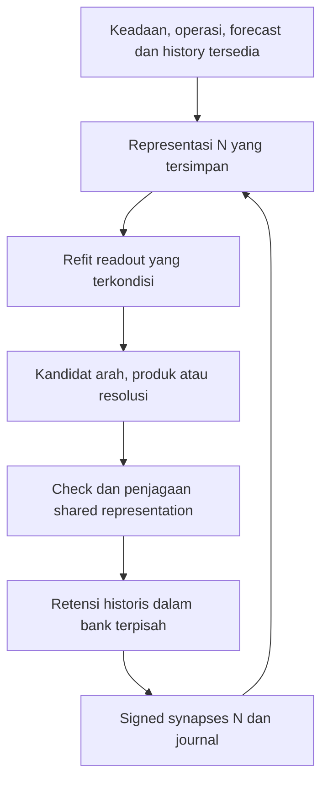

# Audit pembatasan representasi S2-R8

Sumber implementasi R7 `f0451da0`, main `11c6e0a7`. Sumber Brain tetap S2-R2 sequence 80735. Seluruh 443 payload arsip autentik diperiksa secara streaming; checkpoint dan WAL lengkap cocok dengan hash yang dipublikasikan. Tidak ada checkpoint R3–R7 yang dijadikan sumber bobot.

| Tahap autentik | Sequence | Unit neural | Sinaps | Fitur numerik |
|---|---:|---:|---:|---:|
| A–E1 | 75331 | 57 | 94 | 0 |
| S1 | 75866 | 256 | 5820 | 26 |
| S2-R2 continuation | 80735 | 274 | 6408 | 32 |

Angka fitur numerik berbeda dari jumlah seluruh neuron. Peningkatan unit S1 juga mencakup scaffolding sumber numerik dan proyeksi, sehingga satu fitur baru tidak selalu berarti hanya satu neuron tambahan.

**A. Mengapa S1 memperoleh 26 fitur sementara S2 berhenti pada 32?** S1 memulai bagian numerik N yang kosong. Pembelajaran S2 melanjutkan basis berisi 26 fitur tersebut. `maxNFeatures=32` dalam `neural_resolution.go` adalah batas seluruh circuit numerik, bukan tambahan 32 fitur untuk kemampuan baru. Enam slot sisanya terisi saat S2/R2. Satu Brain telah keliru diperlakukan sebagai satu anggaran basis numerik kecil untuk seluruh tugas berikutnya.

**B. Penghentinya.** `growthAllowed` pada `learnNMetric` mensyaratkan panjang circuit di bawah `nMetricFeatureLimit(proposal)`. Default historis adalah 32; R3 menyediakan intervensi 64. Validasi proposal dan restore juga hanya menerima 32/64. Menaikkan konstanta saja berisiko membuat checkpoint tidak bisa dipulihkan. Candidate trace juga memiliki batas bentuk 64 yang harus diberi versi saat kapasitas riset diperluas.

**C. FixedBasis.** Nilai true melewati perubahan resolusi dan membuat growthAllowed false. Jalur reuse R7 juga secara eksplisit mewajibkan fixed basis 32. Residual baru yang informatif tidak dapat mengalahkan syarat struktural ini. Pada R5, FixedBasis bergantung kondisi eksperimen; bukan seluruh R3–R7 menggunakan satu konfigurasi identik.

**D. Pertumbuhan tanpa merusak S1.** Writer memperluas bobot head lain dengan nol dan tidak menyambungkan circuit baru ke readout lama secara otomatis. Penjagaan shared-representation menelusuri parent secara transitif. Arah/center/resolusi yang dipakai head lain tidak boleh diubah oleh lesson lokal. Private leaf boleh disesuaikan. Mekanisme ini dapat menjaga fungsi numerik lama dengan tepat, tetapi retensi perilaku A–E1 tetap harus diuji; keberadaan satu pointer Brain belum membuktikan transfer semua kemampuan.

**E. Lokasi aliasing.** Codec S1 menyimpan 36 aktivitas secara terpisah, bukan hanya rata-rata populasi. Codec S2 menambahkan forecast serta history di reverse lag lain; vektor N memiliki 448 koordinat. Informasi yang tidak dikirim codec, seperti gain operasi mendatang yang tersembunyi, tetap tidak tersedia. Proyeksi learned axis dapat menghilangkan arah pembeda. Kuantisasi dapat menggabungkan nilai berdekatan; tanh(round(code)) dapat menyaturasi menjadi nilai sama walau metric berbeda. Fitting dapat gagal menggunakan perbedaan yang masih ada. Karena itu raw input, metric, activation dan hasil prediksi diperiksa terpisah. Codec residual utilitas R7 kehilangan korespondensi activity–weight–delta; codec itu tidak dijadikan pengganti tugas utama S2.

**F. Fleksibilitas lama.** Kandidat proyeksi global lama menggunakan korelasi residual dengan input. Ia dapat kehilangan hubungan simetris atau konteks kecil. Produk hanya berasal dari pasangan fitur yang sudah ada, diranking lalu dibatasi delapan kandidat per lesson. Produk tidak menciptakan akses ke kanal mentah baru yang tidak pernah diproyeksikan. Refinement R4–R6 terbatas pada private leaf dan kandidat blok tertentu. R8 menambahkan arah koordinat/blok yang diranking dari Fit pada orde linear/kuadratik serta kandidat resolusi sebanding variasi data. Jawaban tugas tidak dihardcode; arah, center, resolusi dan bobot yang lolos ditulis lewat signed synapses N.

R3 telah benar-benar menambah delapan fitur, dari 32 ke 40. RMSE pooled 32 adalah 0.00999193, sedangkan arm bertambah adalah 0.01057028; efek −5,79%, CI95 [−15,91%, +2,48%]. Kontribusi inferensi fitur baru tidak membuktikan prosedur pertumbuhan mengalahkan kontrol latihan. R8 mempertahankan pembedaan ilmiah tersebut.

## Jalur yang diperbaiki

Protokol adaptif baru memilih pertumbuhan dari bukti; FixedBasis hanya intervensi kontrol eksplisit. Batas 96 pada eksperimen adalah anggaran sumber daya yang belum tentu digunakan, dengan restore guard implementasi 256. Tidak ada klaim Brain tak terbatas. Replay protokol historis tetap memakai hukum lama sehingga sumber autentik tidak diinterpretasi ulang.

Fitter ridge terstandar berasal dari workspace numerik native R7, diperluas ke kandidat adaptif. Workspace dibuang setelah admission; semua koefisien yang dipakai inferensi berada di N. Kandidat diukur pada parameter dyadic yang dapat direkonstruksi writer secara tepat. Memoization evaluasi immutable hanya hidup selama satu pencarian kandidat dan selalu dibuang ketika circuit di-clone untuk diubah.

Pengembangan seed 13 awal menunjukkan pertumbuhan tetapi retensi S2 lama gagal pada dua blok. Versi perbaikan menambahkan dua bank historis R2 sebagai retention-only evidence memakai gate yang sudah ada. Dataset final baru tetap terpisah. Seluruh kegagalan, termasuk percobaan yang dijalankan dari direktori kerja salah, dipertahankan sebagai bukti pengembangan dan tidak dihitung sebagai keberhasilan konfirmatori.
