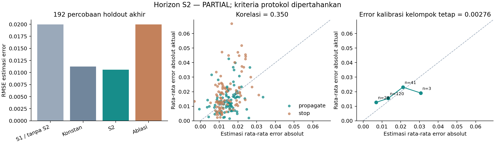

# Horizon S2 — Prediction Error Awareness & Neural Self-Evaluation

16 November 2026. **Status ilmiah: PARTIAL.** Ada pembelajaran sinaptik nyata,
tetapi estimasi pra-operasi belum mengungguli baseline konstan sesuai ambang
yang dibekukan. Hasil ini diterima sebagai infrastruktur dan bukti penelitian
yang perlu perbaikan, bukan sebagai kemampuan self-evaluation yang sudah lulus.

| Penilaian | Hasil |
| --- | --- |
| Tujuan | Mempelajari besaran error prediksi S1 sebelum operasi native. |
| Implementasi | Berjalan pada satu Brain A–E1 → S1 → S2; signed numerical learning native yang sudah ada. |
| Pengujian | Pembelajaran, ablation, kalibrasi agregat, retensi dan persistence lulus; gate holdout dan diskriminasi gagal. |
| Keputusan | **PARTIAL / perlu perbaikan**. Kode dan artefak layak ditinjau sebagai penelitian. |
| Langkah berikutnya | Diagnosis penerimaan pembelajaran setelah pengalaman baru dan pemanfaatan konteks error; pertahankan continuation ini. S3 belum siap dimulai. |

## 1. Sumber dan kesiapan engineering

Main tepat `11c6e0a78547d68a0be8f78b3c801e912722608d`, setelah merge PR #73.
CI push pasca-merge [43849652337](https://github.com/mpsprintit-spec/horizon-artificial-brain/actions/runs/43849652337)
completed/success; validate dan monitor success, diperiksa sebelum observasi S2.
Rincian audit tersedia di [READINESS.md](READINESS.md).

Byte asli arsip S1 berhasil dibaca: 66.545.340 byte, SHA-256
`7ca53ea11b2a56a149f466d65a1d31733581d893ea810b3003ba3a3895fb12e7`.
Seluruh 57 payload cocok manifest. `TestS1VerifyArtifact` memulihkan checkpoint
dan suffix journal tanpa mengulang akuisisi atau holdout S1. Sumber adalah
`s1/lineage/s1-continuation.json`, sequence **75866**, checksum native
`15105e910a7d1fcc0b1cdf4b2883493c498abbabc5afae3626dd0f9bb18ba2bf`.
Identity `horizon-primary-brain`; 256 neuron, 5820 sinaps, 24 PatternSynapses,
10752 native policy updates. SHA-256 checkpoint
`d9bf6662a17c262922806672bcf53fe1484e5eb552ff0ec6699c21142333d64b` dan journal
`3c692c4dccaa33ebac748bcafe06be8b4a21a036317d3fe0e0ec813060b0b9dd` cocok.

Satu salinan penelitian dilanjutkan sepanjang S2. Salinan untuk oracle,
kontrol dan ablation tidak menggantikan lineage ini. Checkpoint produksi,
arsitektur, hukum neural, batas fitur, dan parameter S1 tidak di-reset.
S1 tetap **PARTIAL**, termasuk kegagalan retensi historisnya.

## 2. Implementasi dan representasi

S1 menghasilkan tiga proyeksi aktivitas asli untuk propagate(gain=1) dan stop.
Target S2 adalah **rata-rata absolute error ketiga proyeksi**, dalam satuan
normalisasi S1. Residual signed, absolute error dan rata-ratanya dihitung
sesudah operasi native aktual. Pengurangan ini adalah error recognition dan
sinyal pengajaran; ia tidak dianggap bukti neural error anticipation.

Input S2 memuat keadaan dan konteks S1 sebelum operasi, operasi yang diminta,
tiga forecast S1 yang benar-benar dibaca dari sinaps terlatih, serta tiga error
absolut percobaan sebelumnya dan indikator konteksnya. Error sebelumnya adalah
konteks pengukuran yang disediakan adapter, bukan tabel jawaban atau memori
kognitif kedua. Koordinat numerik S1 dipertahankan ketika input tambahan
disisipkan. Tipe `s2Pre` tidak membawa after-state atau error percobaan saat ini.

`LearnCompositionWithDiagnosis → learnNMetric` mempelajari query error baru
pada fitur numerik N yang sama. Empat fitur relasional native dan satu populasi
query empat neuron ditambahkan: final **264 neuron / 6244 sinaps / 24
PatternSynapses / 30 fitur numerik**. Ada **424 sinaps baru**, nol sinaps lama
yang dihapus atau berubah parameter setelah activation sesaat dikecualikan.
Seluruh 26 fitur S1 dan parameternya bertahan. Batas 32 fitur tidak dinaikkan.

Tidak ada regressor eksternal, uncertainty controller atau mesin kognitif baru.
Adapter menentukan operasi untuk eksperimen. Native causal policy dipertahankan
dengan **10752 updates**; outcome observasi memakai `Learn=false`. S2 ini tidak
membuktikan bahwa policy memilih tindakan berdasarkan estimasi error.

## 3. Protokol beku dan pemisahan data

[DESIGN.md](DESIGN.md) menentukan metode dan formula sebelum akuisisi.
`PROTOCOL.json` dibekukan sebelum pembelajaran dan final holdout, SHA-256
**`74995f41ae93a1bc4a327bbbf8d1d171689bb83a3c49762e1578c31d84e2b167`**.
Salinan kode akuisisi asli beserta hash-nya disimpan di artefak. Penambahan
verifier setelah akuisisi tidak mengubah learner, budget, checkpoint atau gate.

| Data / tahap | Ukuran | Penggunaan |
| --- | ---: | --- |
| Development seed211 | 64 | Diagnosis/admission native; dipakai berulang, bukan holdout independen. |
| Training seed223 | 64 | Pelajaran 1–8. |
| Pengalaman baru seed227 | 64 | Diamati pada lineage yang sama setelah pelajaran 8; pelajaran 9–16. |
| Final seed307 | 96 | Keadaan baru; rentang amplitudo 0,05–0,65. |
| Final seed401 | 96 | Pergeseran rentang ke 0,07–0,73 dan preceding-stop, masih dalam cakupan S1. |
| Continuation seed607 | 4 | Pengalaman native tanpa akuisisi baru setelah restart. |

Anggaran tetap **16 numeric learning commands**, dengan **4 commit** diterima
dan 12 ditolak. Tidak dipilih stage terbaik dari final holdout; kandidat adalah
stage16. Tidak ada latihan setelah holdout atau penurunan ambang.

SD error development **0,00807150**; tercile rendah **0,00991446**, tinggi
**0,01474652**, sehingga variasi error memenuhi syarat identifiabilitas awal.
Konstanta utama = rata-rata error blok training pertama **0,01388515**.
Kontrol tambahan memakai rata-rata seluruh 128 training. Kedua baseline
konstan masuk gate RMSE. Native precision untuk pembelajaran = **0,002**.

Gate utama: RMSE kandidat ≤80% RMSE masing-masing baseline konstan dan kontrol
tanpa belajar pada **setiap seed**; korelasi pooled ≥0,5; error kalibrasi ≤0,003;
ablation RMSE ≥120% kandidat; retensi time-matched ≤1e-7; restart/replay exact.
Rincian lengkap tetap tersedia dalam protokol, bukan disetel dari hasil akhir.

## 4. Perbandingan kontrol dan generalisasi

Seluruh metrik berikut memakai **192 percobaan yang sama**. Error yang diukur
adalah error estimasi S2 terhadap magnitude error S1, bukan RMSE prediksi S1.

| Kondisi | RMSE | MAE | Korelasi | Error kalibrasi |
| --- | ---: | ---: | ---: | ---: |
| A — S1 asli tanpa S2 | 0,01994034 | 0,01671116 | 0 | 0,01671116 |
| B — konstan training blok pertama | 0,01124012 | 0,00768044 | 0 | 0,00282601 |
| B tambahan — konstan seluruh training | 0,01154259 | 0,00772224 | 0 | 0,00385713 |
| C — mekanisme numerik tersedia, belum belajar S2 | 0,01994034 | 0,01671116 | 0 | 0,01671116 |
| D — S2 terlatih | **0,01059194** | **0,00751493** | **0,350216** | **0,00276144** |
| E — incoming synapses query S2 dihilangkan | 0,01994034 | 0,01671116 | 0 | 0,01671116 |

Kontrol C memakai bank dan 26 fitur numerik S1 yang telah tersedia, tetapi query
error belum diakuisisi sehingga keluarannya nol. Ia bukan kontrol dengan
topologi identik 264 neuron. Kontrol E mempertahankan topologi kandidat dan
menghilangkan 172 incoming sinaps nonzero ke query S2, termasuk readout/bias.
Maka A/C dan E mempunyai keluaran sama melalui intervensi yang berbeda; batas
pencocokan struktur ini dinyatakan terbuka.

| Final stream | RMSE S2 | RMSE konstan utama | Rasio kandidat / konstan | Gate ≤0,8 |
| --- | ---: | ---: | ---: | --- |
| Seed307 | 0,00756511 | 0,00771340 | 0,98078 | **FAIL** |
| Seed401, shifted | 0,01292855 | 0,01389907 | 0,93017 | **FAIL** |

Perbaikan pooled terhadap konstanta utama hanya **5,77%**, dibanding syarat
20% pada masing-masing stream. Korelasi 0,350216 juga gagal ambang 0,5.
Analisis bootstrap berpasangan pasca-holdout (4000 pengulangan; blok8 per
stream; seed1703) memberi CI95 gain RMSE **[-0,00012591; +0,00138619]**,
meliputi nol. Analisis tambahan ini bukan gate baru atau pemilihan model.

Pada propagate, RMSE S2 **0,00862987** sedikit lebih buruk dari konstan
**0,00835878**; pada stop **0,01224351** dibanding **0,01352078**. Jadi hasil
pooled tidak boleh diklaim sebagai peningkatan merata di kedua operasi.

## 5. Kalibrasi, kondisi dan ablation

Lima batas bin yang dibekukan: 0,00916484; 0,01832968; 0,02749452;
0,03665936; 0,04582420, dengan kelompok overflow. Kelompok tak terisi tidak
diinterpretasikan sebagai bukti coverage. Nilai keluaran bukan probabilitas.

| Bin terisi | N | Estimasi rata-rata | Error aktual rata-rata |
| --- | ---: | ---: | ---: |
| 0 | 28 | 0,00690801 | 0,01268710 |
| 1 | 120 | 0,01328583 | 0,01541049 |
| 2 | 41 | 0,02116668 | 0,02308978 |
| 3 | 3 | 0,03064640 | 0,01912158 |

Calibration error **0,00276144** memenuhi 0,003. Namun konstanta utama juga
menghasilkan 0,00282601; kalibrasi agregat ini tidak cukup membuktikan
diskriminasi reliabilitas. Dua dari 192 output mentah bernilai negatif untuk
target magnitude nonnegatif; tidak dilakukan clipping yang menyembunyikannya.

Pada 51 kasus error rendah, MAE S2 **0,00653639** versus konstanta utama
**0,00746293**. Pada 87 kasus tinggi, **0,01048545** versus **0,01155800**.
Konstanta seluruh training lebih baik dari S2 pada kelompok rendah
(0,00643181), sebuah keterbatasan yang tetap dilaporkan. Selisih estimasi
kelompok tinggi-rendah dalam operasi yang sama positif: propagate **0,00405323**,
stop **0,00526098**; tetapi gate korelasi tetap gagal.

Ablation query mengembalikan RMSE ke **0,01994034**, sekitar **1,88×** kandidat.
Menghapus seluruh witnesses dari salinan evaluasi tidak mengubah prediksi.
Ini mendukung kontribusi sinaptik pada keluaran, tanpa membuktikan bahwa
besarnya manfaat atas baseline sederhana telah memenuhi kriteria.

## 6. Belajar dari error sebelumnya: batas yang ditemukan

Menghapus konteks error sebelumnya menghasilkan prediksi/RMSE yang sama
persis: delta **0**. Tidak ada koordinat source aktif di slot tambahan forecast
S1/error-history (koordinat56 dan seterusnya). Empat fitur yang tumbuh berupa
relasi dari fitur sebelumnya. Karena itu penggunaan kausal konteks error
terdahulu dan penggunaan eksplisit kanal forecast tambahan **belum terbukti**.
S2 tetap menerima target error dari forecast nyata S1, tetapi input yang
ditawarkan tidak otomatis berarti input tersebut telah dipelajari.

Blok pengalaman baru 64 kasus memiliki RMSE pra-pembaruan **0,00777306**.
Seluruh pelajaran9–16 ditolak, sehingga tidak terjadi perbaikan lanjutan dari
blok ini. Diagnosis tiap pelajaran mencatat 41 trial kandidat terkena
`retention-regression` dan 80 `no-check-improvement`; alasan dapat bertumpang
tindih. Batas fitur belum penuh (30/32), sehingga bukan bukti bahwa kegagalan
semata-mata disebabkan kapasitas. Ini menunjukkan titik diagnosis admission
dan retensi pengalaman; belum membuktikan target mustahil dipelajari.

S2-A memiliki observasi error nyata dan target yang terverifikasi; S2-B/C
memiliki pembelajaran terbatas yang gagal gate holdout/discrimination; S2-D
belum menunjukkan kontribusi history atau adaptasi setelah blok baru; S2-E
telah diuji dan belum lulus ambang generalisasi yang dibekukan.

## 7. Retensi S1 dan A–E1

Prediksi S1 dari source75866 dan kandidat pada seluruh 576 koordinat observasi
S2 **identik persis**: maksimum drift **0**. RMSE S1 pada distribusi S2 ini
**0,02326859**, dengan **553/576** koordinat dalam toleransi0,05 (96,00694%).
Angka ini tidak disebut peningkatan dari RMSE S1 historis0,024033 karena
distribusinya berbeda. Semua perbandingan retensi memakai input yang sama.
Verifier tambahan memeriksa tiga proyeksi, kontras keadaan dan ablation
readout S1 dari observasi S2 yang telah disimpan, tanpa akuisisi S1 baru.
Menghilangkan readout sinaptik meningkatkan RMSE S1 menjadi **0,17561637**;
korelasi kontras keadaan S1 yang dipertahankan **0,970377**. Ketiga metrik
proyeksi tersedia lengkap dalam `S1-attribution.json`.

Kontrol tanpa pelajaran S2 menerima 720 command observasi native yang sama.
Enam belas revisi numerik diganti trial native tanpa belajar untuk mencapai
sequence yang sama secara sah; sequence/timestamp tidak diedit manual.
Oracle historis dipakai tanpa perubahan.

| Retensi | Setelah S2 final | Setelah restart + continuation |
| --- | ---: | ---: |
| Waktu/sequence kontrol setara | 76602 | 76617 |
| Delta oracle A/B/C/D maksimum | **0** | **0** |
| C operation selection | **6/6** | **6/6** |
| E1 nuisance-resistant selection | **35/36** | **35/36** |
| Drift prediksi S1 | **0** | **0** |

A ordered/temporal, B recurrent context dan D observed intermediate reuse
bertahan dalam cakupan oracle tersebut. Semua 5820 sinaps sumber S1 tetap
parameter-identik setelah transient activation dikecualikan; 24 PatternSynapses,
neuron asli dan state policy tetap dipertahankan.

Kegagalan margin retensi **historis S1** tetap berlaku: delta1,24193894e-6
melebihi ambang1e-7. Gate S2 time-matched yang dipraregistrasikan tidak
menghapus hasil historis atau menaikkan status ilmiah S1.

## 8. Persistence dan artefak

| State | Sequence | Checksum native |
| --- | ---: | --- |
| Source continuation S1 | 75866 | `15105e910a7d1fcc0b1cdf4b2883493c498abbabc5afae3626dd0f9bb18ba2bf` |
| S2 final / restarted | 76602 | `f89ea7ef61330d6ebf6bc0cd60bf5aec49fe6a487e440843cbc646dfefdc13a3` |
| S2 continuation | **76617** | `b87285e38a321d45e4da920f219b388d1a2d061554042d2dd0f109883b38ab9d` |

SHA-256 final **`60ae19a96f22183596e04b5a6965a6ecef2b9efd45a75755dcf1ebd97c5c3c42`**;
continuation **`b85a818a84efb8185cdbf7003e14a8acd3d070c798f3ae7e053729ec9fc76ba0`**.
Journal lengkap **44.021.001 byte**, SHA-256
**`e7157d7c1e3b03c38abd3825e3a6bd8aef0bcbdf748b291e48d99de356d7d527`**.
Prefix journal S1 **41.106.826 byte** tetap identik, termasuk seluruh riwayat
A–E1. Counter kebijakan10752 terpisah dari 16 numeric commands/4 commits S2.

Runtime dimatikan di antara proses tahap eksperimen. Final dan restarted
identik byte/checksum; source S1, checkpoint pretraining dan final dengan WAL
memulihkan state final lengkap yang sama. Rollback checkpoint/prefix-WAL pulih
identik. Empat trial continuation tidak memperoleh pelajaran baru; replay dari
final memulihkan continuation lengkap dan readout yang sama. Verifier berjalan
lagi pada proses baru. Seluruh 388 target error dan pre-operation receipt
dicocokkan secara independen; input/forecast/estimate tersimpan sebelum command
target. Kode forward tidak menerima hasil operasi saat ini.

Checkpoint final, continuation, journal lengkap, kontrol, dataset, prediksi,
protokol, diagnosis, logs dan manifest disediakan dalam paket pemulihan yang
ditautkan dari [ARTIFACT.md](ARTIFACT.md). [RESTORE.md](RESTORE.md) menjelaskan
verifikasi dan recovery; artefak tidak hanya berupa nama/hash. Source asli
S1 tetap utuh dan dapat diakses terpisah.

## 9. Validasi engineering dan riwayat negatif

Pemeriksaan native source, 16 lesson receipts, final holdout, time-matched
retention, complete suffix replay, rollback, restart, continuation dan verifier
lulus sebagai pengujian engineering. Hasil PASS pengujian tidak mengubah
kegagalan gate ilmiah S2. Pengujian terarah dengan race juga lulus untuk
numeric/native coexistence, admission matrix, architecture dependency boundary,
durable/lost acknowledgement dan native numerical rollout recovery. Tidak ada
perubahan serving atau bundle produksi; benchmark besar tidak diulang.

Satu percobaan verifier retensi restart diluncurkan dari direktori yang salah
dan gagal menemukan fixture relatif `testdata/continual_flexibility_v1.json`.
Log kegagalan disimpan. Audit kemudian memulihkan prefix kontrol yang sudah
ada dan berjalan dari direktori runtime yang benar; tidak ada pelatihan,
holdout baru, perubahan threshold atau perubahan checkpoint kandidat.

Paket arsip awal yang belum dipublikasikan ditolak verifier karena skrip
reproduksi berubah ketika pengemasan berlangsung. Paket final disusun ulang
setelah input final dibekukan; log penolakan disimpan. Verifier memeriksa hash
byte yang benar-benar ditulis, bukan menerima nama/hash dari laporan.

## 10. Keputusan integrasi dan kesiapan S3

**PARTIAL dipertahankan.** Kandidat menyimpan pembelajaran neural nyata,
tetapi belum memenuhi peningkatan atas baseline konstan atau korelasi yang
disyaratkan, dan belum memanfaatkan konteks error terdahulu. Checkpoint ini
layak dipertahankan untuk kelanjutan penelitian pada lineage yang sama.

Kode, protokol dan bukti layak ditinjau untuk integrasi sebagai **infrastruktur
penelitian dengan hasil negatif yang utuh**. Pemeriksaan CI kandidat berada
pada PR; readiness baseline tidak dianggap pengganti CI kandidat. Tidak ada
promosi Brain produksi, merge otomatis, atau latihan S3.

**Kesiapan kemampuan untuk S3: belum siap.** Continuation76617 adalah kandidat
sumber yang dapat dipulihkan, bukan persetujuan memulai S3. Pekerjaan berikutnya
harus menjelaskan mengapa kanal history/forecast tidak direkrut dan mengapa
pengalaman baru ditolak oleh admission, dengan tetap melanjutkan checkpoint
ini dan menetapkan protokol/holdout baru sebelum perbaikan diuji.
